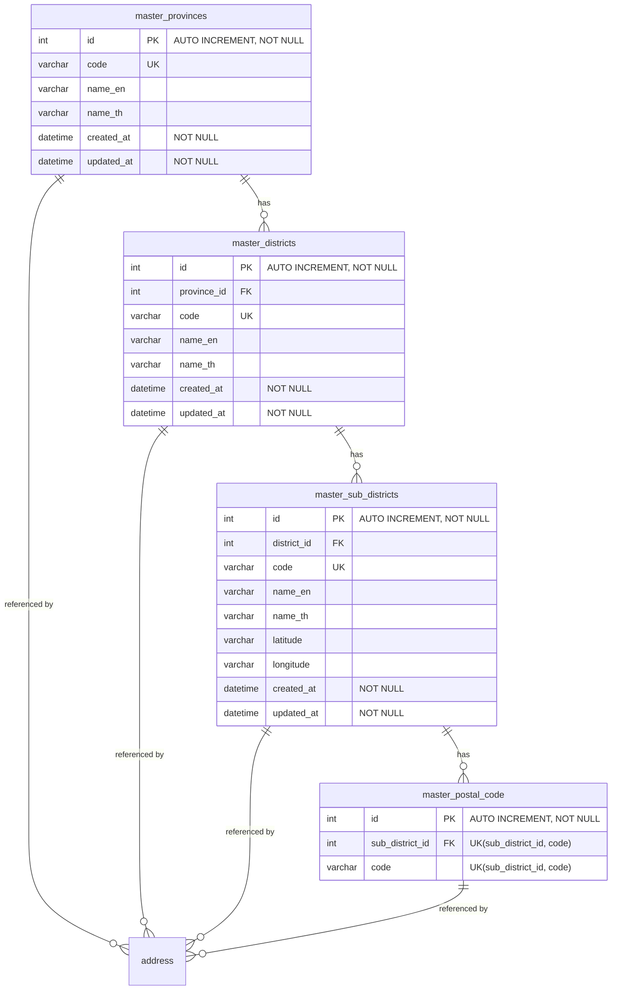
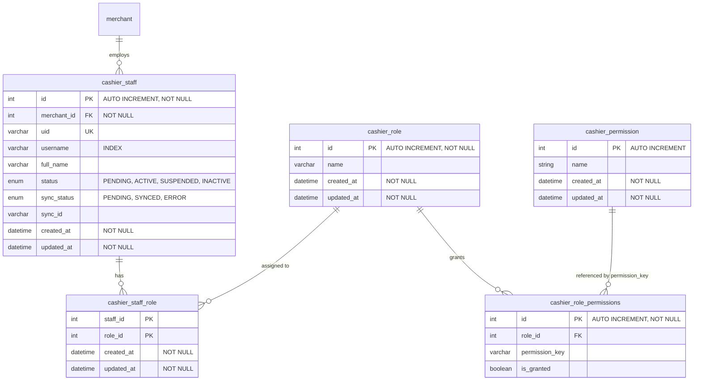

# ER-Diagram

## merchant & cashier

```mermaid
erDiagram
  merchant {
    int id PK "AUTO INCREMENT, NOT NULL"
    varchar uid UK "NOT NULL"
    varchar partner_id UK "NOT NULL"
    varchar name_en "NOT NULL"
    varchar name_th "NOT NULL"
    datetime created_at "NOT NULL"
    datetime updated_at "NOT NULL"
  }

  merchant_profile {
    int id PK "AUTO INCREMENT, NOT NULL"
    int merchant_id FK "NOT NULL"
    varchar mid UK
    datetime created_at "NOT NULL"
    datetime updated_at "NOT NULL"
  }

  merchant_credential {
    int id PK "AUTO INCREMENT, NOT NULL"
    int merchant_id FK "NOT NULL"
    enum provider "POS_CASHIER, NOT NULL"
    varchar client_id UK "NOT NULL"
    varchar client_secret "SHA-256 hash, NOT NULL"
    datetime created_at "NOT NULL"
    datetime updated_at "NOT NULL"
  }

  store {
    int id PK "AUTO INCREMENT, NOT NULL"
    int merchant_id FK "NOT NULL"
    varchar uid UK "NOT NULL"
    varchar sid UK "NOT NULL"
    varchar name_en "NOT NULL"
    varchar name_th "NOT NULL"
    datetime created_at "NOT NULL"
    datetime updated_at "NOT NULL"
  }

  address {
    int id PK "AUTO INCREMENT, NOT NULL"
    int province_id FK "NOT NULL"
    int district_id FK "NOT NULL"
    int sub_district_id FK "NOT NULL"
    int postal_code_id FK "NOT NULL"
    varchar address_1
    decimal latitude
    decimal longitude
    datetime created_at "NOT NULL"
    datetime updated_at "NOT NULL"
  }

  map_store_address {
    int store_id PK "NOT NULL"
    int address_id PK "NOT NULL"
    enum type "REGISTERED, CONTRACT, NOT NULL"
    datetime created_at "NOT NULL"
    datetime updated_at "NOT NULL"
  }

  terminal {
    int id PK "AUTO INCREMENT, NOT NULL"
    varchar uid UK "NOT NULL"
    varchar tid UK "NOT NULL"
    varchar name_en "NOT NULL"
    varchar name_th "NOT NULL"
    datetime created_at "NOT NULL"
    datetime updated_at "NOT NULL"
  }

  map_store_terminal {
    int store_id PK "NOT NULL"
    int terminal_id PK "NOT NULL"
    datetime created_at "NOT NULL"
    datetime updated_at "NOT NULL"
  }

  product {
    int id PK "AUTO INCREMENT, NOT NULL"
    int merchant_id FK "NOT NULL"
    int brand_id FK
    varchar uid UK "NOT NULL"
    varchar name_en "NOT NULL"
    varchar name_th "NOT NULL"
    varchar sku "NOT NULL"
    varchar barcode
    decimal base_price "10,4, NOT NULL"
    varchar image_url
    varchar unit_name
    datetime created_at "NOT NULL"
    datetime updated_at "NOT NULL"
  }

  brand {
    int id PK "AUTO INCREMENT, NOT NULL"
    varchar uid UK "NOT NULL"
    varchar name_en "NOT NULL"
    varchar name_th "NOT NULL"
    datetime created_at "NOT NULL"
    datetime updated_at "NOT NULL"
  }

  map_store_product {
    int store_id PK "NOT NULL"
    int product_id PK "NOT NULL"
    int stock "NOT NULL"
    decimal price "10,4, NOT NULL"
    int sync_version "DEFAULT 0, NOT NULL"
    datetime created_at "NOT NULL"
    datetime updated_at "NOT NULL"
  }

  member {
    int id PK "AUTO INCREMENT, NOT NULL"
    varchar phone_no UK "NOT NULL"
    datetime created_at "NOT NULL"
    datetime updated_at "NOT NULL"
  }

  wallet {
    int id PK "AUTO INCREMENT, NOT NULL"
    decimal balance "10,4, DEFAULT 0, NOT NULL"
    datetime created_at "NOT NULL"
    datetime updated_at "NOT NULL"
  }

  map_member_wallet {
    int member_id PK "NOT NULL"
    int wallet_id PK "NOT NULL"
    enum type "POINT, CASH, NOT NULL"
  }

  order {
    int id PK "AUTO INCREMENT, NOT NULL"
    int merchant_id FK "NOT NULL"
    int store_id FK "NOT NULL"
    int terminal_id FK "NOT NULL"
    int cashier_staff_id FK "NOT NULL"
    int member_id FK
    varchar order_id UK "NOT NULL"
    decimal total_amount "10,4, NOT NULL"
    varchar status "PENDING, PAID, VOID, REFUNDED, NOT NULL"
    boolean is_synced "DEFAULT FALSE, NOT NULL"
    datetime created_at "NOT NULL"
    datetime updated_at "NOT NULL"
  }

  order_items {
    int id PK "AUTO INCREMENT, NOT NULL"
    int order_id FK "NOT NULL"
    int product_id FK "NOT NULL"
    decimal price "10,4, NOT NULL"
    int quantity "NOT NULL"
    datetime created_at "NOT NULL"
    datetime updated_at "NOT NULL"
  }

  order_sync_logs {
    int id PK "AUTO INCREMENT, NOT NULL"
    int store_id FK "NOT NULL"
    varchar pos_temp_id "INDEX"
    varchar global_order_id "INDEX"
    datetime synced_at
  }

  merchant ||--o{ merchant_profile : "has"
  merchant ||--o{ merchant_credential : "has"
  merchant ||--o{ store : "owns"
  merchant ||--o{ product : "owns"
  brand |o--o{ product : "categorizes"
  store ||--o{ map_store_address : "has"
  address ||--o{ map_store_address : "used by"
  store ||--o{ map_store_terminal : "has"
  terminal ||--o{ map_store_terminal : "assigned to"
  store ||--o{ map_store_product : "sells"
  product ||--o{ map_store_product : "sold in"
  member ||--o{ map_member_wallet : "has"
  wallet ||--o{ map_member_wallet : "belongs to"
  merchant ||--o{ order : "receives"
  store ||--o{ order : "receives"
  terminal ||--o{ order : "creates"
  cashier_staff ||--o{ order : "creates"
  member |o--o{ order : "places"
  order ||--|{ order_items : "contains"
  product ||--o{ order_items : "referenced by"
  store ||--o{ order_sync_logs : "has"
```

## Master Data Province & District & Sub District

## Cashier

# Data Dictionary

## table: merchant

ข้อมูลร้านค้า/ผู้ประกอบการ

| Field Name | Data Type | Length | Key | Nullable | Description                       |
| ---------- | --------- | ------ | --- | -------- | --------------------------------- |
| id         | int       | -      | PK  | No       | รหัสอ้างอิงภายใน (auto increment) |
| uid        | varchar   | 100    | UK  | No       | รหัสอ้างอิงสากลของ merchant       |
| partner_id | varchar   | 20     | UK  | No       | รหัส partner                      |
| name_en    | varchar   | 255    |     | No       | ชื่อร้านค้าภาษาอังกฤษ             |
| name_th    | varchar   | 255    |     | No       | ชื่อร้านค้าภาษาไทย                |
| created_at | datetime  | -      |     | No       | วันที่สร้าง                       |
| updated_at | datetime  | -      |     | No       | วันที่แก้ไขล่าสุด                 |

## table: merchant_profile

ข้อมูลโปรไฟล์ของ merchant

| Field Name  | Data Type | Length | Key | Nullable | Description                        |
| ----------- | --------- | ------ | --- | -------- | ---------------------------------- |
| id          | int       | -      | PK  | No       | รหัสอ้างอิงภายใน (auto increment)  |
| merchant_id | int       | -      | FK  | No       | อ้างอิง merchant.id                |
| mid         | varchar   | 50     | UK  | Yes      | Merchant ID                        |
| created_at  | datetime  | -      |     | No       | วันที่สร้าง                        |
| updated_at  | datetime  | -      |     | No       | วันที่แก้ไขล่าสุด                  |

## table: merchant_credential

ข้อมูล credential สำหรับเชื่อมต่อระบบภายนอกของ merchant (1 merchant มี 1 credential ต่อ provider: unique `(merchant_id, provider)`)

| Field Name    | Data Type | Length | Key | Nullable | Description                                  |
| ------------- | --------- | ------ | --- | -------- | -------------------------------------------- |
| id            | int       | -      | PK  | No       | รหัสอ้างอิงภายใน (auto increment)            |
| merchant_id   | int       | -      | FK  | No       | อ้างอิง merchant.id                          |
| provider      | enum      | -      |     | No       | ผู้ให้บริการ: `POS_CASHIER`                  |
| client_id     | varchar   | 255    | UK  | No       | Client ID (สร้างโดยระบบ ไม่ซ้ำ)              |
| client_secret | varchar   | 255    |     | No       | SHA-256 hash (hex) ของ Client Secret ห้ามเก็บค่าจริง แสดงค่าจริงครั้งเดียวตอนสร้าง/rotate |
| created_at    | datetime  | -      |     | No       | วันที่สร้าง                                  |
| updated_at    | datetime  | -      |     | No       | วันที่แก้ไขล่าสุด                            |

## table: store

ข้อมูลสาขา/ร้านค้าย่อยของ merchant

| Field Name  | Data Type | Length | Key | Nullable | Description                       |
| ----------- | --------- | ------ | --- | -------- | --------------------------------- |
| id          | int       | -      | PK  | No       | รหัสอ้างอิงภายใน (auto increment) |
| merchant_id | int       | -      | FK  | No       | อ้างอิง merchant.id               |
| uid         | varchar   | 100    | UK  | No       | รหัสอ้างอิงสากลของ store          |
| sid         | varchar   | 50     | UK  | No       | Store ID                          |
| name_en     | varchar   | 255    |     | No       | ชื่อสาขาภาษาอังกฤษ                |
| name_th     | varchar   | 255    |     | No       | ชื่อสาขาภาษาไทย                   |
| created_at  | datetime  | -      |     | No       | วันที่สร้าง                       |
| updated_at  | datetime  | -      |     | No       | วันที่แก้ไขล่าสุด                 |

## table: address

ข้อมูลที่อยู่

| Field Name      | Data Type | Length | Key | Nullable | Description                       |
| --------------- | --------- | ------ | --- | -------- | --------------------------------- |
| id              | int       | -      | PK  | No       | รหัสอ้างอิงภายใน (auto increment) |
| province_id     | int       | -      | FK  | No       | อ้างอิง master_provinces.id              |
| district_id     | int       | -      | FK  | No       | อ้างอิง master_districts.id              |
| sub_district_id | int       | -      | FK  | No       | อ้างอิง master_sub_districts.id          |
| postal_code_id  | int       | -      | FK  | No       | อ้างอิง master_postal_code.id            |
| address_1       | varchar   | 255    |     | Yes      | รายละเอียดที่อยู่                 |
| latitude        | decimal   | 10,7   |     | Yes      | ละติจูด                           |
| longitude       | decimal   | 10,7   |     | Yes      | ลองจิจูด                          |
| created_at      | datetime  | -      |     | No       | วันที่สร้าง                       |
| updated_at      | datetime  | -      |     | No       | วันที่แก้ไขล่าสุด                 |

## table: map_store_address

ตารางเชื่อมระหว่าง store กับ address (many-to-many)

| Field Name | Data Type | Length | Key | Nullable | Description                              |
| ---------- | --------- | ------ | --- | -------- | ---------------------------------------- |
| store_id   | int       | -      | PK  | No       | อ้างอิง store.id                         |
| address_id | int       | -      | PK  | No       | อ้างอิง address.id                       |
| type       | enum      | -      |     | No       | ประเภทที่อยู่: `REGISTERED`, `CONTRACT`  |
| created_at | datetime  | -      |     | No       | วันที่สร้าง                              |
| updated_at | datetime  | -      |     | No       | วันที่แก้ไขล่าสุด                        |

## table: terminal

ข้อมูลเครื่อง POS

| Field Name | Data Type | Length | Key | Nullable | Description                       |
| ---------- | --------- | ------ | --- | -------- | --------------------------------- |
| id         | int       | -      | PK  | No       | รหัสอ้างอิงภายใน (auto increment) |
| uid        | varchar   | 100    | UK  | No       | รหัสอ้างอิงสากลของ terminal       |
| tid        | varchar   | 50     | UK  | No       | Terminal ID                       |
| name_en    | varchar   | 255    |     | No       | ชื่อเครื่องภาษาอังกฤษ             |
| name_th    | varchar   | 255    |     | No       | ชื่อเครื่องภาษาไทย                |
| created_at | datetime  | -      |     | No       | วันที่สร้าง                       |
| updated_at | datetime  | -      |     | No       | วันที่แก้ไขล่าสุด                 |

## table: map_store_terminal

ตารางเชื่อมระหว่าง store กับ terminal (many-to-many)

| Field Name  | Data Type | Length | Key | Nullable | Description         |
| ----------- | --------- | ------ | --- | -------- | ------------------- |
| store_id    | int       | -      | PK  | No       | อ้างอิง store.id    |
| terminal_id | int       | -      | PK  | No       | อ้างอิง terminal.id |
| created_at  | datetime  | -      |     | No       | วันที่สร้าง         |
| updated_at  | datetime  | -      |     | No       | วันที่แก้ไขล่าสุด   |

## table: product

ข้อมูลสินค้าของ merchant

| Field Name  | Data Type | Length | Key | Nullable | Description                       |
| ----------- | --------- | ------ | --- | -------- | --------------------------------- |
| id          | int       | -      | PK  | No       | รหัสอ้างอิงภายใน (auto increment) |
| merchant_id | int       | -      | FK  | No       | อ้างอิง merchant.id               |
| brand_id    | int       | -      | FK  | Yes      | อ้างอิง brand.id                  |
| uid         | varchar   | 100    | UK  | No       | รหัสอ้างอิงสากลของสินค้า          |
| name_en     | varchar   | 255    |     | No       | ชื่อสินค้าภาษาอังกฤษ              |
| name_th     | varchar   | 255    |     | No       | ชื่อสินค้าภาษาไทย                 |
| sku         | varchar   | 100    |     | No       | รหัส SKU                          |
| barcode     | varchar   | 100    |     | Yes      | บาร์โค้ด                          |
| base_price  | decimal   | 10,4   |     | No       | ราคาตั้งต้น                       |
| image_url   | varchar   | 500    |     | Yes      | URL รูปสินค้า                     |
| unit_name   | varchar   | 50     |     | Yes      | หน่วยนับ                          |
| created_at  | datetime  | -      |     | No       | วันที่สร้าง                       |
| updated_at  | datetime  | -      |     | No       | วันที่แก้ไขล่าสุด                 |

## table: brand

ข้อมูลแบรนด์สินค้า

| Field Name | Data Type | Length | Key | Nullable | Description                       |
| ---------- | --------- | ------ | --- | -------- | --------------------------------- |
| id         | int       | -      | PK  | No       | รหัสอ้างอิงภายใน (auto increment) |
| uid        | varchar   | 100    | UK  | No       | รหัสอ้างอิงสากลของแบรนด์          |
| name_en    | varchar   | 255    |     | No       | ชื่อแบรนด์ภาษาอังกฤษ              |
| name_th    | varchar   | 255    |     | No       | ชื่อแบรนด์ภาษาไทย                 |
| created_at | datetime  | -      |     | No       | วันที่สร้าง                       |
| updated_at | datetime  | -      |     | No       | วันที่แก้ไขล่าสุด                 |

## table: map_store_product

สินค้าที่ขายในแต่ละ store พร้อมราคาและสต็อก

| Field Name   | Data Type | Length | Key | Nullable | Description                          |
| ------------ | --------- | ------ | --- | -------- | ------------------------------------ |
| store_id     | int       | -      | PK  | No       | อ้างอิง store.id                     |
| product_id   | int       | -      | PK  | No       | อ้างอิง product.id                   |
| stock        | int       | -      |     | No       | จำนวนสต็อกคงเหลือ                    |
| price        | decimal   | 10,4   |     | No       | ราคาขายของ store นี้                 |
| sync_version | int       | -      |     | No       | เวอร์ชันสำหรับ sync (default 0)      |
| created_at   | datetime  | -      |     | No       | วันที่สร้าง                          |
| updated_at   | datetime  | -      |     | No       | วันที่แก้ไขล่าสุด                    |

## table: member

ข้อมูลสมาชิก

| Field Name | Data Type | Length | Key | Nullable | Description                       |
| ---------- | --------- | ------ | --- | -------- | --------------------------------- |
| id         | int       | -      | PK  | No       | รหัสอ้างอิงภายใน (auto increment) |
| phone_no   | varchar   | 20     | UK  | No       | เบอร์โทรศัพท์สมาชิก               |
| created_at | datetime  | -      |     | No       | วันที่สร้าง                       |
| updated_at | datetime  | -      |     | No       | วันที่แก้ไขล่าสุด                 |

## table: wallet

กระเป๋าเงิน/แต้มของสมาชิก

| Field Name | Data Type | Length | Key | Nullable | Description                       |
| ---------- | --------- | ------ | --- | -------- | --------------------------------- |
| id         | int       | -      | PK  | No       | รหัสอ้างอิงภายใน (auto increment) |
| balance    | decimal   | 10,4   |     | No       | ยอดคงเหลือ (default 0)            |
| created_at | datetime  | -      |     | No       | วันที่สร้าง                       |
| updated_at | datetime  | -      |     | No       | วันที่แก้ไขล่าสุด                 |

## table: map_member_wallet

ตารางเชื่อมระหว่าง member กับ wallet

| Field Name | Data Type | Length | Key | Nullable | Description                     |
| ---------- | --------- | ------ | --- | -------- | ------------------------------- |
| member_id  | int       | -      | PK  | No       | อ้างอิง member.id               |
| wallet_id  | int       | -      | PK  | No       | อ้างอิง wallet.id               |
| type       | enum      | -      |     | No       | ประเภทกระเป๋า: `POINT`, `CASH`  |

## table: order

ข้อมูลคำสั่งซื้อ/ใบเสร็จ

| Field Name       | Data Type | Length | Key | Nullable | Description                                          |
| ---------------- | --------- | ------ | --- | -------- | ---------------------------------------------------- |
| id               | int       | -      | PK  | No       | รหัสอ้างอิงภายใน (auto increment)                    |
| merchant_id      | int       | -      | FK  | No       | อ้างอิง merchant.id                                  |
| store_id         | int       | -      | FK  | No       | อ้างอิง store.id                                     |
| terminal_id      | int       | -      | FK  | No       | อ้างอิง terminal.id                                  |
| cashier_staff_id | int       | -      | FK  | No       | อ้างอิง cashier_staff.id (แคชเชียร์ที่ทำรายการ)      |
| member_id        | int       | -      | FK  | Yes      | อ้างอิง member.id (ถ้ามีสมาชิก)                      |
| order_id         | varchar   | 100    | UK  | No       | เลขที่คำสั่งซื้อ                                     |
| total_amount     | decimal   | 10,4   |     | No       | ยอดรวม                                               |
| status           | varchar   | 20     |     | No       | สถานะ: `PENDING`, `PAID`, `VOID`, `REFUNDED`         |
| is_synced        | boolean   | -      |     | No       | sync ขึ้นศูนย์แล้วหรือไม่ (default false)            |
| created_at       | datetime  | -      |     | No       | วันที่สร้าง                                          |
| updated_at       | datetime  | -      |     | No       | วันที่แก้ไขล่าสุด                                    |

## table: order_items

รายการสินค้าในคำสั่งซื้อ

| Field Name | Data Type | Length | Key | Nullable | Description                       |
| ---------- | --------- | ------ | --- | -------- | --------------------------------- |
| id         | int       | -      | PK  | No       | รหัสอ้างอิงภายใน (auto increment) |
| order_id   | int       | -      | FK  | No       | อ้างอิง order.id                  |
| product_id | int       | -      | FK  | No       | อ้างอิง product.id                |
| price      | decimal   | 10,4   |     | No       | ราคา ณ เวลาที่ขาย                 |
| quantity   | int       | -      |     | No       | จำนวน                             |
| created_at | datetime  | -      |     | No       | วันที่สร้าง                       |
| updated_at | datetime  | -      |     | No       | วันที่แก้ไขล่าสุด                 |

## table: order_sync_logs

บันทึกการ sync คำสั่งซื้อจากเครื่อง POS (offline) ขึ้นศูนย์

| Field Name      | Data Type | Length | Key | Nullable | Description                          |
| --------------- | --------- | ------ | --- | -------- | ------------------------------------ |
| id              | int       | -      | PK  | No       | รหัสอ้างอิงภายใน (auto increment)    |
| store_id        | int       | -      | FK  | No       | อ้างอิง store.id                     |
| pos_temp_id     | varchar   | 100    | IDX | Yes      | รหัสชั่วคราวที่สร้างจากเครื่อง POS   |
| global_order_id | varchar   | 100    | IDX | Yes      | รหัสคำสั่งซื้อจริงจากศูนย์           |
| synced_at       | datetime  | -      |     | Yes      | วันที่ sync สำเร็จ                   |

## table: master_provinces

ข้อมูลหลักจังหวัด

| Field Name | Data Type | Length | Key | Nullable | Description                       |
| ---------- | --------- | ------ | --- | -------- | --------------------------------- |
| id         | int       | -      | PK  | No       | รหัสอ้างอิงภายใน (auto increment) |
| code       | varchar   | 20     | UK  | Yes      | รหัสจังหวัด                       |
| name_en    | varchar   | 255    |     | Yes      | ชื่อภาษาอังกฤษ                    |
| name_th    | varchar   | 255    |     | Yes      | ชื่อภาษาไทย                       |
| created_at | datetime  | -      |     | No       | วันที่สร้าง                       |
| updated_at | datetime  | -      |     | No       | วันที่แก้ไขล่าสุด                 |

## table: master_districts

ข้อมูลหลักอำเภอ/เขต

| Field Name  | Data Type | Length | Key | Nullable | Description                       |
| ----------- | --------- | ------ | --- | -------- | --------------------------------- |
| id          | int       | -      | PK  | No       | รหัสอ้างอิงภายใน (auto increment) |
| province_id | int       | -      | FK  | Yes      | อ้างอิง master_provinces.id              |
| code        | varchar   | 20     | UK  | Yes      | รหัสอำเภอ/เขต                     |
| name_en     | varchar   | 255    |     | Yes      | ชื่อภาษาอังกฤษ                    |
| name_th     | varchar   | 255    |     | Yes      | ชื่อภาษาไทย                       |
| created_at  | datetime  | -      |     | No       | วันที่สร้าง                       |
| updated_at  | datetime  | -      |     | No       | วันที่แก้ไขล่าสุด                 |

## table: master_sub_districts

ข้อมูลหลักตำบล/แขวง

| Field Name  | Data Type | Length | Key | Nullable | Description                       |
| ----------- | --------- | ------ | --- | -------- | --------------------------------- |
| id          | int       | -      | PK  | No       | รหัสอ้างอิงภายใน (auto increment) |
| district_id | int       | -      | FK  | Yes      | อ้างอิง master_districts.id              |
| code        | varchar   | 20     | UK  | Yes      | รหัสตำบล/แขวง                     |
| name_en     | varchar   | 255    |     | Yes      | ชื่อภาษาอังกฤษ                    |
| name_th     | varchar   | 255    |     | Yes      | ชื่อภาษาไทย                       |
| latitude    | varchar   | 50     |     | Yes      | ละติจูด                           |
| longitude   | varchar   | 50     |     | Yes      | ลองจิจูด                          |
| created_at  | datetime  | -      |     | No       | วันที่สร้าง                       |
| updated_at  | datetime  | -      |     | No       | วันที่แก้ไขล่าสุด                 |

## table: master_postal_code

ข้อมูลหลักรหัสไปรษณีย์ (รหัสไปรษณีย์หนึ่งรหัสใช้ร่วมกันได้หลายตำบล จึง unique ที่คู่ `sub_district_id, code`)

| Field Name      | Data Type | Length | Key    | Nullable | Description                       |
| --------------- | --------- | ------ | ------ | -------- | --------------------------------- |
| id              | int       | -      | PK     | No       | รหัสอ้างอิงภายใน (auto increment) |
| sub_district_id | int       | -      | FK, UK | Yes      | อ้างอิง master_sub_districts.id          |
| code            | varchar   | 10     | UK     | Yes      | รหัสไปรษณีย์                      |

## table: cashier_staff

ข้อมูลพนักงานแคชเชียร์

| Field Name  | Data Type | Length | Key | Nullable | Description                                       |
| ----------- | --------- | ------ | --- | -------- | ------------------------------------------------- |
| id          | int       | -      | PK  | No       | รหัสอ้างอิงภายใน (auto increment)                 |
| merchant_id | int       | -      | FK  | No       | อ้างอิง merchant.id (merchant ที่พนักงานสังกัด)   |
| uid         | varchar   | 100    | UK  | Yes      | รหัสอ้างอิงสากลของพนักงาน                         |
| username    | varchar   | 100    | IDX | Yes      | ชื่อผู้ใช้                                        |
| full_name   | varchar   | 255    |     | Yes      | ชื่อ-นามสกุล                                      |
| status      | enum      | -      |     | Yes      | สถานะ: `PENDING`, `ACTIVE`, `SUSPENDED`, `INACTIVE` |
| sync_status | enum      | -      |     | Yes      | สถานะ sync: `PENDING`, `SYNCED`, `ERROR`          |
| sync_id     | varchar   | 100    |     | Yes      | รหัสอ้างอิงในระบบปลายทางที่ sync                  |
| created_at  | datetime  | -      |     | No       | วันที่สร้าง                                       |
| updated_at  | datetime  | -      |     | No       | วันที่แก้ไขล่าสุด                                 |

## table: cashier_role

ข้อมูล role ของแคชเชียร์

| Field Name | Data Type | Length | Key | Nullable | Description                       |
| ---------- | --------- | ------ | --- | -------- | --------------------------------- |
| id         | int       | -      | PK  | No       | รหัสอ้างอิงภายใน (auto increment) |
| name       | varchar   | 100    |     | Yes      | ชื่อ role                         |
| created_at | datetime  | -      |     | No       | วันที่สร้าง                       |
| updated_at | datetime  | -      |     | No       | วันที่แก้ไขล่าสุด                 |

## table: cashier_staff_role

ตารางเชื่อมระหว่างพนักงานกับ role (many-to-many)

| Field Name | Data Type | Length | Key | Nullable | Description              |
| ---------- | --------- | ------ | --- | -------- | ------------------------ |
| staff_id   | int       | -      | PK  | No       | อ้างอิง cashier_staff.id |
| role_id    | int       | -      | PK  | No       | อ้างอิง cashier_role.id  |
| created_at | datetime  | -      |     | No       | วันที่สร้าง              |
| updated_at | datetime  | -      |     | No       | วันที่แก้ไขล่าสุด        |

## table: cashier_permission

รายการสิทธิ์ทั้งหมดในระบบ

| Field Name | Data Type | Length | Key | Nullable | Description                       |
| ---------- | --------- | ------ | --- | -------- | --------------------------------- |
| id         | int       | -      | PK  | No       | รหัสอ้างอิงภายใน (auto increment) |
| name       | varchar   | 100    |     | Yes      | ชื่อสิทธิ์ (permission key)       |
| created_at | datetime  | -      |     | No       | วันที่สร้าง                       |
| updated_at | datetime  | -      |     | No       | วันที่แก้ไขล่าสุด                 |

## table: cashier_role_permissions

สิทธิ์ของแต่ละ role

| Field Name     | Data Type | Length | Key | Nullable | Description                                                  |
| -------------- | --------- | ------ | --- | -------- | ------------------------------------------------------------ |
| id             | int       | -      | PK  | No       | รหัสอ้างอิงภายใน (auto increment)                            |
| role_id        | int       | -      | FK  | Yes      | อ้างอิง cashier_role.id                                      |
| permission_key | varchar   | 100    |     | Yes      | ตรงกับ cashier_permission.name (อ้างอิงเชิง logic ไม่มี FK)  |
| is_granted     | boolean   | -      |     | Yes      | ได้รับสิทธิ์หรือไม่                                          |
