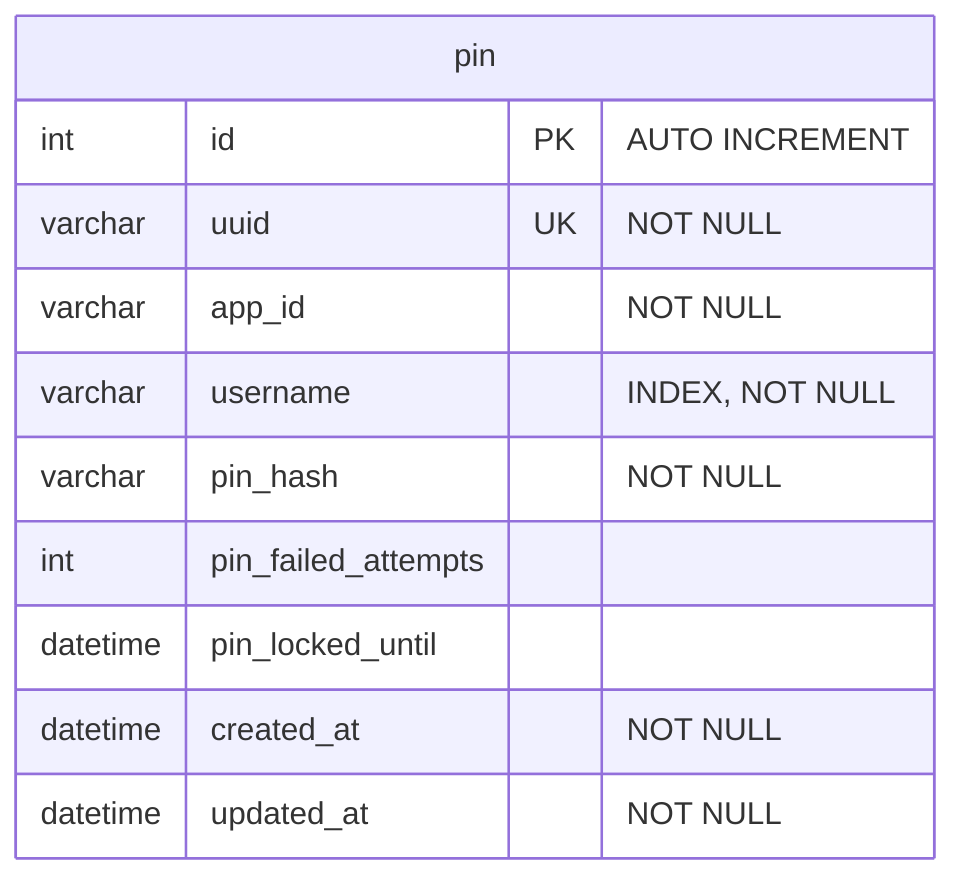

## Relationships

`pin` ไม่มี foreign key ไปยังตารางอื่น (standalone) — เชื่อมกับพนักงานเชิง logic ผ่าน `app_id` + `username`:

| app_id    | แอป     | username อ้างอิงกับ      |
| --------- | ------- | ------------------------ |
| `APP0001` | cashier | `cashier_staff.username` |
| `APP0002` | center  | `center_staff.username`  |

# Data Dictionary

## table: pin

ข้อมูล PIN ของผู้ใช้งานแต่ละแอปพลิเคชัน

| Field Name          | Data Type | Length | Key | Nullable | Description                                   |
| ------------------- | --------- | ------ | --- | -------- | --------------------------------------------- |
| id                  | int       | -      | PK  | No       | รหัสอ้างอิงภายใน (auto increment)             |
| uuid                | varchar   | 100    | UK  | No       | รหัสอ้างอิงสากลของ PIN                        |
| app_id              | varchar   | 20     |     | No       | รหัสแอปที่ใช้ PIN นี้ (APP0001 = cashier, APP0002 = center) |
| username            | varchar   | 100    | IDX | No       | ชื่อผู้ใช้เจ้าของ PIN (cashier_staff.username / center_staff.username ตาม app_id) |
| pin_hash            | varchar   | 255    |     | No       | PIN ที่เข้ารหัสแบบ hash (ห้ามเก็บ PIN จริง)   |
| pin_failed_attempts | int       | -      |     | Yes      | จำนวนครั้งที่กรอก PIN ผิดติดต่อกัน            |
| pin_locked_until    | datetime  | -      |     | Yes      | เวลาที่ PIN ถูกล็อกถึง (null = ไม่ถูกล็อก)    |
| created_at          | datetime  | -      |     | No       | วันที่สร้าง                                   |
| updated_at          | datetime  | -      |     | No       | วันที่แก้ไขล่าสุด                             |
