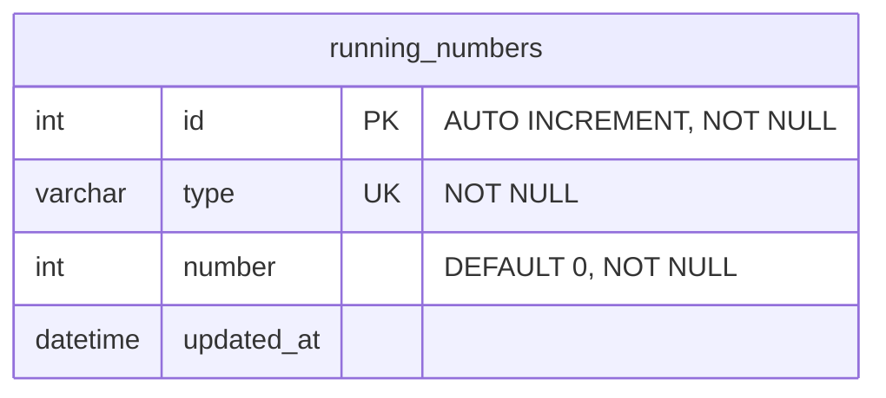

## Relationships

`running_numbers` ไม่มี foreign key ไปยังตารางอื่น (standalone) — แต่ละแถวคือตัวนับของ 1 `type` (เช่น `product_version`) ใช้สร้างเลขลำดับ/เวอร์ชันที่เพิ่มขึ้นเรื่อย ๆ

# Data Dictionary

## table: running_numbers

ตัวนับเลขรัน แยกตามประเภท (`type`)

| Field Name | Data Type | Length | Key | Nullable | Description                                       |
| ---------- | --------- | ------ | --- | -------- | ------------------------------------------------- |
| id         | int       | -      | PK  | No       | รหัสอ้างอิงภายใน (auto increment)                 |
| type       | varchar   | 255    | UK  | No       | ประเภทของตัวนับ เช่น `product_version`            |
| number     | int       | -      |     | No       | ค่าตัวนับปัจจุบัน (default 0)                     |
| updated_at | datetime  | -      |     | Yes      | วันที่แก้ไขล่าสุด                                 |
