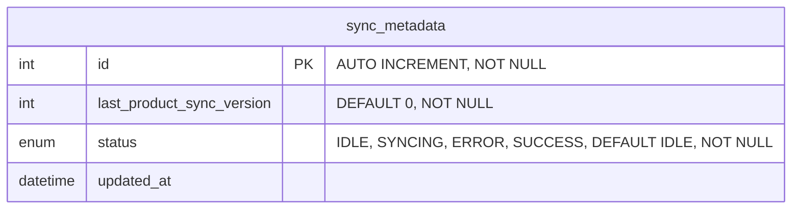

## Relationships

`sync_metadata` ไม่มี foreign key ไปยังตารางอื่น (standalone) — เก็บสถานะการ sync ล่าสุดของระบบ โดย `last_product_sync_version` เทียบกับ `map_store_product.sync_version`

# Data Dictionary

## table: sync_metadata

ข้อมูลสถานะและเวอร์ชันการ sync

| Field Name                | Data Type | Length | Key | Nullable | Description                                                    |
| ------------------------- | --------- | ------ | --- | -------- | -------------------------------------------------------------- |
| id                        | int       | -      | PK  | No       | รหัสอ้างอิงภายใน (auto increment)                              |
| last_product_sync_version | int       | -      |     | No       | เวอร์ชันสินค้าล่าสุดที่ sync แล้ว (default 0)                  |
| status                    | enum      | -      |     | No       | สถานะ sync: `IDLE`, `SYNCING`, `ERROR`, `SUCCESS` (default `IDLE`) |
| updated_at                | datetime  | -      |     | Yes      | วันที่แก้ไขล่าสุด                                              |
