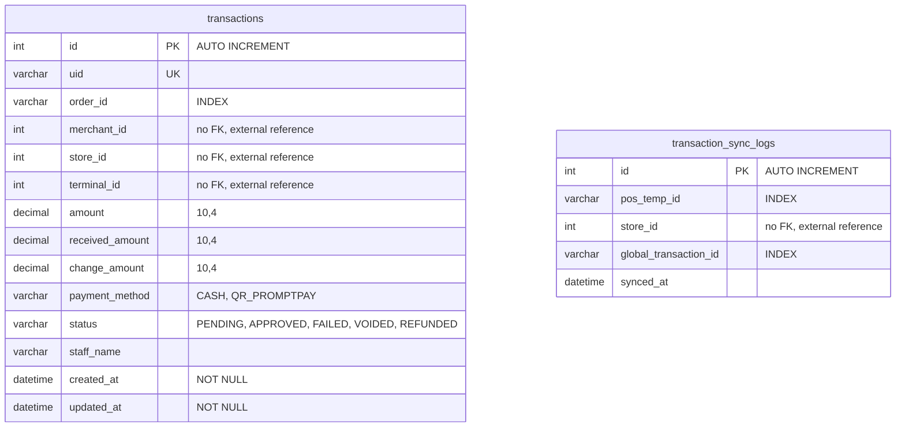

## Relationships

ตารางทั้งสองไม่มี foreign key ไปยังตารางอื่น (standalone) — `merchant_id`, `store_id`, `terminal_id` เป็นการอ้างอิงเชิง logic ไปยังข้อมูล merchant / store / terminal และ `transaction_sync_logs.global_transaction_id` อ้างอิงเชิง logic กับ `transactions.uid`

# Data Dictionary

## table: transactions

ข้อมูลธุรกรรมการชำระเงิน (sync มาจาก POS)

| Field Name     | Data Type | Length | Key | Nullable | Description                                                       |
| -------------- | --------- | ------ | --- | -------- | ----------------------------------------------------------------- |
| id             | int       | -      | PK  | No       | รหัสอ้างอิงภายใน (auto increment)                                 |
| uid            | varchar   | 100    | UK  | No       | รหัสอ้างอิงสากลของธุรกรรม                                         |
| order_id       | varchar   | 100    | IDX | Yes      | รหัสออเดอร์ของธุรกรรม (ว่างได้หากไม่ผูกกับออเดอร์)                |
| merchant_id    | int       | -      |     | Yes      | รหัส merchant เจ้าของธุรกรรม (ไม่มี FK, อ้างอิงภายนอก)            |
| store_id       | int       | -      |     | Yes      | รหัสร้านค้าที่เกิดธุรกรรม (ไม่มี FK, อ้างอิงภายนอก)               |
| terminal_id    | int       | -      |     | Yes      | รหัสเครื่อง terminal ที่ทำรายการ (ไม่มี FK, อ้างอิงภายนอก)        |
| amount         | decimal   | 10,4   |     | Yes      | จำนวนเงินของธุรกรรม (precision 10, scale 4)                       |
| received_amount | decimal  | 10,4   |     | Yes      | เงินที่รับจากลูกค้า (ว่างได้ เช่น ชำระด้วย QR)                    |
| change_amount  | decimal   | 10,4   |     | Yes      | เงินทอน (ว่างได้)                                                 |
| payment_method | varchar   | 20     |     | Yes      | วิธีชำระเงิน: `CASH`, `QR_PROMPTPAY`                              |
| status         | varchar   | 20     |     | Yes      | สถานะ: `PENDING`, `APPROVED`, `FAILED`, `VOIDED`, `REFUNDED`     |
| staff_name     | varchar   | 255    |     | Yes      | ชื่อพนักงานที่ทำรายการ                                            |
| created_at     | datetime  | -      |     | No       | วันที่สร้าง                                                       |
| updated_at     | datetime  | -      |     | No       | วันที่แก้ไขล่าสุด                                                 |

## table: transaction_sync_logs

บันทึกการ sync ธุรกรรมจาก POS เข้าสู่ระบบศูนย์ (จับคู่ id ชั่วคราวของ POS กับ id สากล)

| Field Name            | Data Type | Length | Key | Nullable | Description                                              |
| --------------------- | --------- | ------ | --- | -------- | -------------------------------------------------------- |
| id                    | int       | -      | PK  | No       | รหัสอ้างอิงภายใน (auto increment)                        |
| pos_temp_id           | varchar   | 100    | IDX | Yes      | รหัสชั่วคราวของธุรกรรมที่ POS สร้างขึ้นก่อน sync          |
| store_id              | int       | -      |     | Yes      | รหัสร้านค้าที่ sync (ไม่มี FK, อ้างอิงภายนอก)             |
| global_transaction_id | varchar   | 100    | IDX | Yes      | รหัสสากลของธุรกรรมหลัง sync (ตรงกับ `transactions.uid`)  |
| synced_at             | datetime  | -      |     | Yes      | วันเวลาที่ sync สำเร็จ                                   |
