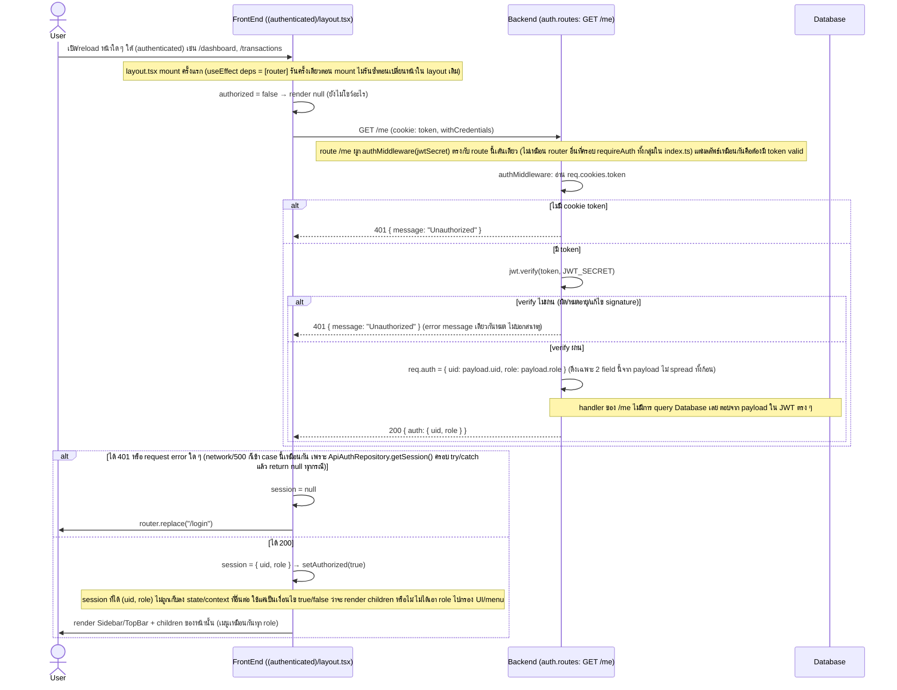

# Get Session (/me) Flow (ของจริงในโค้ดปัจจุบัน)

## สิ่งที่ต่างจาก "มาตรฐานที่ควรมี"

โค้ดปัจจุบัน (`apps/portal-service/src/presentation/routes/auth.routes.ts` — handler ของ `GET /me`, `apps/portal-service/src/presentation/middleware/AuthMiddleware.ts`, ฝั่ง client `apps/portal/src/infrastructure/repositories/ApiAuthRepository.ts` และ `apps/portal/src/app/(authenticated)/layout.tsx`) มีพฤติกรรมดังนี้ เทียบกับ flow login/logout ที่มีเอกสารอยู่แล้ว (`staff-management-login.md`, `staff-management-logout.md`):

| ประเด็น | ที่เป็นอยู่จริง | มาตรฐานที่ควรมี | เหตุผล |
|---|---|---|---|
| ข้อมูลที่ตอบกลับ | `authMiddleware` สร้าง `req.auth` แบบ whitelist เฉพาะ `{ uid, role }` จาก JWT payload (ไม่ spread payload ทั้งก้อน) ก่อนส่งต่อให้ `/me` ตอบกลับ | เหมือนเดิม | ไม่พบปัญหาใหญ่ — ไม่มีการหลุด claim อื่นของ JWT (เช่น `iat`/`exp`) ออกไปให้ client เห็นเกินจำเป็น |
| แหล่งข้อมูลตอนตอบ | `/me` ไม่ query Database เลย ตอบจากสิ่งที่ decode ได้จาก JWT cookie ตรง ๆ (`uid`, `role` ตอนออก token เท่านั้น) | ควร (อย่างน้อยเป็นทางเลือก) เช็คสถานะ staff ปัจจุบันจาก DB เช่น ถูกปิดใช้งาน/role ถูกเปลี่ยนหรือยัง ก่อนตอบ หรือมี mechanism revoke token (ดู logout doc) | เพราะไม่มี token revocation (ตามที่ `staff-management-logout.md` ระบุไว้แล้วว่าไม่มี blacklist/tokenVersion) การเปลี่ยน role หรือปิดใช้งาน staff กลางคันจะยังไม่มีผลจนกว่า token จะหมดอายุเอง (สูงสุด 30 นาทีตาม `TOKEN_EXPIRES_IN` ใน `LoginUseCase`) — `/me` เองก็ยืนยัน stale state นี้ต่อไปเรื่อย ๆ โดยไม่รู้ตัว |
| ข้อมูลที่ขาดหายเทียบกับตอน login | ตอน `POST /login` สำเร็จ backend ส่ง `staff: { uid, name, role, merchantId }` กลับมา แต่ JWT ที่ sign เก็บแค่ `{ uid, role }` ดังนั้น `GET /me` (ซึ่ง decode จาก JWT ล้วน ๆ) ไม่มีทางคืน `name`/`merchantId` ได้เลย | ถ้า frontend ต้องใช้ `name`/`merchantId` หลัง refresh ควรมี endpoint/］mechanism ที่ query staff เพิ่ม (เช่น query DB ด้วย `uid` ใน `/me`) แทนที่จะพึ่ง response ของ `/login` ที่มีแค่ตอน login ครั้งเดียว | ปัจจุบัน frontend ไม่ได้ใช้ `name`/`merchantId` จาก `/me` เลยจึงยังไม่เป็นปัญหาที่เห็นผล แต่เป็นข้อจำกัดเชิงสถาปัตยกรรมถ้ามีหน้าไหนต้องโชว์ชื่อ/merchant ของ staff ที่ login อยู่ในอนาคต |
| การจัดการ error ฝั่ง frontend | `ApiAuthRepository.getSession()` ครอบทุก error (401, network error, 500 ฯลฯ) ด้วย `catch { return null }` เหมือนกันหมด แล้ว `layout.tsx` เห็น `null` ก็ `router.replace("/login")` ทันที | ควรแยก 401 (ไม่ได้ login จริง → เด้งไป login) ออกจาก network/5xx error (ควรแสดง retry/error state แทนการเด้งออกจากระบบ) | ถ้า backend ล่มชั่วคราวหรือ network หลุด ผู้ใช้ที่ login ค้างอยู่จะถูกเด้งไปหน้า login ทั้งที่ session จริง ๆ ยังไม่หมดอายุ ทำให้ประสบการณ์ใช้งานสับสนและดูเหมือน bug การ login |
| การใช้ role ที่ได้จาก /me | `session.role` ถูกอ่านมาแค่เพื่อเช็คว่ามี session หรือไม่ (ทิ้งไปหลังจากนั้น) ไม่ได้ถูกเก็บ/ส่งต่อไปใช้กรองเมนูหรือ UI ใด ๆ — `menuItems` ใน `layout.tsx` เป็น array คงที่ เหมือนกันทุก role | ควรเก็บ role ไว้ใน context/state แล้วใช้กรองเมนู/ปุ่มตาม role จริง | สอดคล้องกับที่พบในเอกสารอื่น (เช่น merchants-list, transaction-list) ว่า backend เองก็ไม่มี RBAC จริงจัง ฝั่ง frontend ก็ไม่ได้ใช้ข้อมูล role ที่มีอยู่แล้วมาช่วยจำกัดสิทธิ์การมองเห็นเมนูเลย |
| เวลาที่ถูกเรียก | `/me` ถูกเรียกครั้งเดียวตอน `(authenticated)` layout mount (เช่น หน้า refresh หรือเข้าเว็บครั้งแรก) ไม่ได้ถูกเรียกซ้ำทุกครั้งที่เปลี่ยนหน้าในกลุ่มเดียวกัน เพราะ Next.js ไม่ remount layout เดิมตอน client-side navigation | เพียงพอสำหรับ validate session ตอนเข้าเว็บ/refresh อยู่แล้ว หากต้องการความสดของ session ระหว่างใช้งานนาน ๆ ควรมี mechanism เพิ่มเติม (เช่น re-check เป็นระยะ หรือ handle 401 จาก request อื่นแล้วเด้ง login) | ปัจจุบันถ้า token หมดอายุระหว่างที่ผู้ใช้เปิดหน้าเดิมค้างไว้ (ไม่ reload/ไม่เปลี่ยน layout) จะไม่มีอะไร detect ว่า session หมดอายุแล้วจนกว่าจะมี request อื่นโดน 401 หรือ user reload เอง |
| Rate limit / CSRF | ไม่มี rate limit บน `/me` แต่เป็น `GET` ที่ไม่เปลี่ยน state และต้องมี cookie token ที่ valid อยู่แล้วถึงจะได้ข้อมูล | ไม่จำเป็นต้องมี CSRF protection (GET ไม่เปลี่ยน state) แต่ rate limit เบา ๆ ยังช่วยลด load จากการเรียกรัว ๆ ได้ | ความเสี่ยงต่ำกว่า `/login`/endpoint ที่เปลี่ยน state มาก เพราะไม่มี side effect และต้องผ่าน auth ก่อนอยู่แล้ว |
| Audit log | ไม่มีการ log การเรียก `/me` | ไม่จำเป็นต้อง log ทุกครั้งเพราะเป็นแค่ session check แต่ควร log เฉพาะกรณี fail ซ้ำ ๆ ผิดปกติ (เช่น token ปลอมจำนวนมาก) | ใช้แยกแยะ pattern ของการพยายามใช้ token ที่ไม่ valid |
