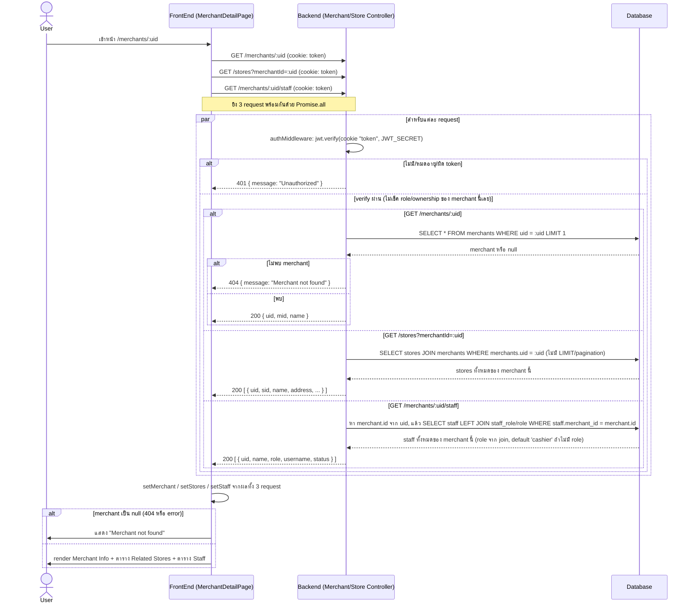

# Merchant Detail Flow (ของจริงในโค้ดปัจจุบัน)

## สิ่งที่ต่างจาก "มาตรฐานที่ควรมี"

โค้ดปัจจุบัน (`MerchantController.getById/getStaff`, `StoreController.getAll`, `apps/portal/src/app/(authenticated)/merchants/[id]/page.tsx`) มีพฤติกรรมดังนี้:

| ประเด็น | ที่เป็นอยู่จริง | มาตรฐานที่ควรมี | เหตุผล |
|---|---|---|---|
| Authorization (RBAC/ownership) | authMiddleware เช็คแค่ token valid ไม่เช็คว่า staff ที่ login มีสิทธิ์ดู merchant นี้หรือไม่ (ใส่ uid merchant อะไรก็ query ได้ถ้า login อยู่) | ควรเช็คว่า role เป็น super admin หรือ merchant นี้เป็นของ staff ที่ login อยู่ ก่อน query | ป้องกัน IDOR: staff ของ merchant A ดูข้อมูล merchant B ได้โดยแค่เปลี่ยน uid ใน URL |
| Consistency ของ error | `/merchants/:uid` และ `/merchants/:uid/staff` ใช้ uid เดียวกัน แต่ `/stores?merchantId=` ถ้า merchant ไม่พบจะได้ array ว่าง ไม่ใช่ 404 | ควรตอบ error/สถานะให้สอดคล้องกันเมื่อ merchant ไม่มีอยู่จริง | ฝั่ง client ต้องเดาเองว่า merchant ไม่มีจริงหรือแค่ไม่มี store/staff |
| Fan-out request | หน้า detail ยิง 3 request แยกกัน (merchant, stores, staff) ไม่มี endpoint รวม | อาจพิจารณาทำ `/merchants/:uid/summary` รวมข้อมูลในครั้งเดียวถ้าต้องการลด round-trip | ลดจำนวน request และปัญหา partial failure (เช่น merchant call fail แต่ stores/staff request ผ่าน) |
| Pagination | รายการ stores/staff ของ merchant ไม่มี limit เลย ดึงมาทั้งหมด | ควรมี limit/pagination ถ้าจำนวน store/staff ต่อ merchant อาจเยอะ | ป้องกัน response ใหญ่เกินไปเมื่อ merchant มี store/staff จำนวนมาก |
| Audit log | ไม่มีการบันทึกว่าใครเปิดดู merchant ไหนบ้าง | ควร log การเข้าถึงข้อมูล merchant รายตัว | ใช้ตรวจสอบย้อนหลังกรณีข้อมูลรั่ว |
