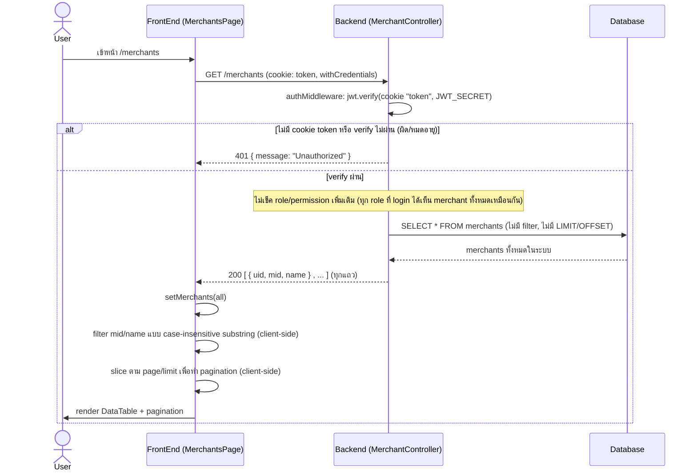

# Merchants List Flow (ของจริงในโค้ดปัจจุบัน)

## สิ่งที่ต่างจาก "มาตรฐานที่ควรมี"

โค้ดปัจจุบัน (`apps/portal-service/src/presentation/routes/merchant.routes.ts`, `MerchantController.getAll`, `GetMerchantsUseCase`, `DrizzleMerchantRepository.findAll`, และฝั่ง client `apps/portal/src/app/(authenticated)/merchants/page.tsx`) มีพฤติกรรมดังนี้ ซึ่งต่างจาก flow มาตรฐานที่ควรทำ:

| ประเด็น | ที่เป็นอยู่จริง | มาตรฐานที่ควรมี | เหตุผล |
|---|---|---|---|
| Auth | เช็คแค่ signature/expiry ของ JWT ผ่าน cookie `token` | เหมือนเดิม แต่ควรแยก error 401 (ไม่มี token) กับ 401 (expired) เพื่อ debug ง่ายขึ้น | ปัจจุบัน error message เดียวกันหมดก็ยังปลอดภัยอยู่ แต่ debug ยาก |
| Authorization (RBAC) | ไม่มีการเช็ค role เลย ทุก staff ที่ login ได้เห็น merchant list ทั้งหมดเหมือนกัน | ควรจำกัดว่า role ไหนดู list merchant ทั้งหมดได้ (เช่นเฉพาะ super admin) | ป้องกัน privilege escalation / เห็นข้อมูล merchant อื่นที่ไม่เกี่ยวข้อง |
| Pagination/Filter | ไม่รับ query param ใด ๆ เลย (`getAll` เรียก `execute()` เปล่า ๆ) ดึงทุกแถวมาที่ frontend แล้วค่อย filter/paginate ในเบราว์เซอร์ | Backend ควรรับ `page/limit/mid/name` แล้ว query แบบ filter+pagination ที่ DB | ถ้า merchant มีจำนวนมาก จะโหลดข้อมูลทั้งหมดมาที่ client ทุกครั้ง เปลืองทั้ง bandwidth และ memory และข้อมูล merchant ทุกตัวจะถูกส่งไปที่ browser แม้จะไม่ได้แสดงก็ตาม |
| Data scoping | ไม่มีการ filter ตาม merchant ของ staff เอง (ทุกคนเห็นทุก merchant) | ถ้าไม่ใช่ super admin ควร filter เฉพาะ merchant ของตัวเอง | ป้องกันเห็นข้อมูล merchant ของบัญชี/ธุรกิจอื่น |
| Payload validation | ไม่มี query params ให้ validate อยู่แล้ว | ถ้าเพิ่ม query param ต้อง validate ด้วย schema (zod) | ป้องกัน invalid input ในอนาคตเมื่อเพิ่ม filter |
| Rate limit / Audit log | ไม่มี | ควรมี rate limit และ audit log การเรียกดู list | ป้องกัน scraping และช่วย trace เหตุการณ์ผิดปกติ |

> หมายเหตุ: เอกสารเวอร์ชันก่อนหน้าของไฟล์นี้เป็น "มาตรฐานที่ควรมี" (สมมติว่ามี query param + RBAC + validation ครบ) ซึ่งยังไม่ตรงกับโค้ดจริง เอกสารนี้แก้ไขให้ diagram หลักตรงกับพฤติกรรมจริงของระบบ ณ ปัจจุบัน และย้ายส่วน "ควรมี" ไปเป็นตารางเปรียบเทียบด้านบนแทน
