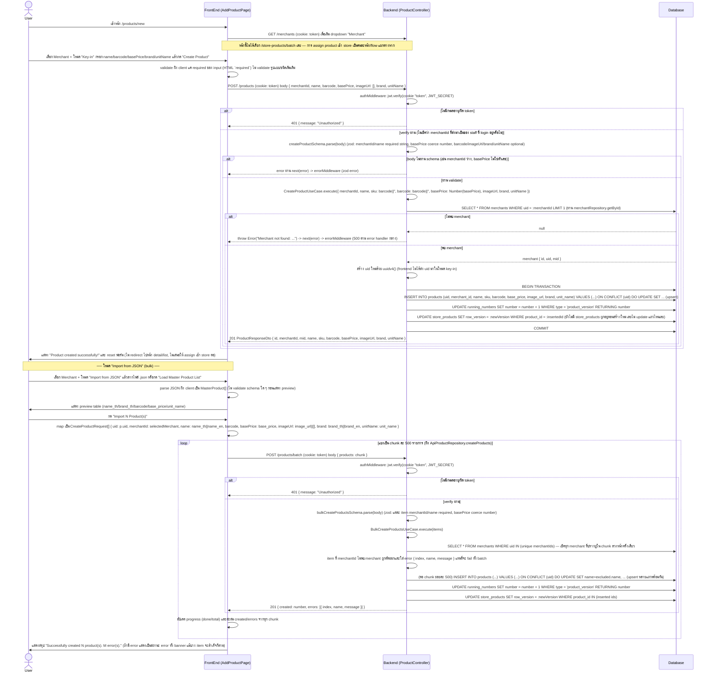

# Product Create Flow (ของจริงในโค้ดปัจจุบัน)

## สิ่งที่ต่างจาก "มาตรฐานที่ควรมี"

โค้ดปัจจุบัน (`ProductController.create/batchCreate`, `CreateProductUseCase`, `BulkCreateProductsUseCase`, `DrizzleProductRepository.save/bulkSave`, และฝั่ง client `apps/portal/src/app/(authenticated)/products/new/page.tsx`, `ApiProductRepository.createProduct/createProducts`) มีพฤติกรรมดังนี้:

| ประเด็น | ที่เป็นอยู่จริง | มาตรฐานที่ควรมี | เหตุผล |
|---|---|---|---|
| Authorization (RBAC/ownership) | authMiddleware เช็คแค่ token valid ไม่เช็คว่า staff ที่ login มีสิทธิ์สร้างสินค้าให้ merchant ที่ระบุใน `merchantId` หรือไม่ (ทั้ง single create และ batch) | ควรเช็คว่า `merchantId` ที่ส่งมาตรงกับ merchant ของ staff (หรือ role super admin) ก่อนสร้าง | ป้องกัน staff ของ merchant A สร้างสินค้าปลอมยัดใส่ merchant B ได้แค่เปลี่ยน merchantId ใน request body |
| Upsert แทน insert ล้วน | ทั้ง `save()` และ `bulkSave()` ใช้ `onConflictDoUpdate` บน `products.uid` คือถ้าส่ง `uid` ที่มีอยู่แล้วจะเป็นการ "แก้ไข" สินค้าเดิมทับ ไม่ใช่สร้างใหม่ แต่ controller/endpoint ชื่อ `POST /products` (create) และ response เป็น `201 Created` เสมอแม้จริง ๆ เป็นการ update | ควรแยก endpoint หรือ behavior ระหว่าง create (ต้องไม่มี uid ซ้ำ, ตอบ 409 ถ้าซ้ำ) กับ update (PUT/PATCH) ให้ชัดเจน หรืออย่างน้อย response ควรบอกว่าเป็นการ insert หรือ update จริง | ปัจจุบันถ้า client (หรือไฟล์ JSON ที่ import) ส่ง uid ที่ชนกับสินค้าเดิมของ merchant อื่นโดยไม่ได้ตั้งใจ ข้อมูลสินค้าเดิมจะถูกเขียนทับเงียบ ๆ โดยไม่มีการแจ้งเตือนหรือปฏิเสธ |
| Error handling ของ "Merchant not found" (single create) | `CreateProductUseCase` throw `Error` ธรรมดาเมื่อไม่พบ merchant แล้วส่งต่อให้ `errorMiddleware` ซึ่งไม่ใช่ error ที่มี status code กำกับ (ไม่ใช่ ValidationError/NotFoundError เฉพาะ) ทำให้พังเป็น response กลางๆ ไม่ใช่ 404/400 ที่สื่อความหมาย | ควร throw custom error (เช่น `NotFoundError`) ที่ errorMiddleware map เป็น 404 พร้อม message ชัดเจนว่า merchant ไม่ถูกต้อง | ฝั่ง client (`err?.response?.data?.message`) จะได้ status/message ที่คาดเดาได้ ไม่ใช่ error 500 generic ซึ่งอาจถูกตีความผิดว่าเป็น server bug |
| Input validation ของราคา/บาร์โค้ด | `createProductSchema`/`bulkCreateProductItemSchema` validate แค่ `basePrice` เป็นตัวเลข (coerce) ไม่มีการเช็คว่าต้อง `> 0`, ไม่ validate รูปแบบ barcode (เช่น ความยาว/ตัวเลขล้วน), ไม่ validate ว่า `imageUrl` เป็น URL ที่ถูกต้อง | ควรเพิ่ม constraint เช่น `basePrice` ต้อง `>= 0` (หรือ `> 0`), validate รูปแบบ barcode/URL ให้เข้มขึ้น | ปัจจุบันสามารถสร้างสินค้าราคาติดลบ (`basePrice: -100`) หรือบาร์โค้ดที่เป็น string อะไรก็ได้ผ่าน validation ได้ |
| ความสอดคล้องระหว่าง key-in กับ batch schema | `createProductSchema` (single) รับ `imageUrl` เป็น `string | string[]` แต่ `bulkCreateProductItemSchema` (batch) รับเฉพาะ `string[]` เท่านั้น — schema สอง endpoint ไม่ตรงกันสำหรับ field เดียวกัน | ควรใช้ shape เดียวกันสำหรับ field ที่ความหมายเหมือนกันในทั้งสอง endpoint หรือมี normalize layer ร่วม | เพิ่มความเสี่ยงเรื่อง maintenance/bug เวลาแก้ schema ฝั่งเดียวแล้วลืมอีกฝั่ง |
| Batch: partial failure ไม่ atomic ข้าม merchant แต่ atomic ภายใน chunk 500 | ถ้า merchant ใน item หนึ่งไม่พบ จะตัด item นั้นออกจาก batch แล้วสร้างที่เหลือต่อ (ไม่ fail ทั้งก้อน) แต่ภายใน 1 chunk ของ 500 รายการที่ผ่าน validation ใช้ `db.transaction` เดียว ถ้า insert แถวใดแถวหนึ่งใน chunk fail (เช่น constraint อื่นที่ไม่ใช่ merchant) ทั้ง chunk 500 รายการนั้นจะ rollback หมด แต่ response กลับไม่บอกว่า chunk ไหน fail ทั้งก้อน | ควร catch error ระดับ chunk แล้วรายงานแยกว่า chunk ไหนสำเร็จ/ล้มเหลวทั้งหมด ไม่ใช่ปล่อยให้ exception หลุดไปที่ `next(error)` เฉย ๆ | ปัจจุบันถ้า chunk ที่ 3 จาก 5 chunk fail กลางทาง (exception จาก DB) request ทั้ง POST /products/batch นั้นจะตอบ error กลับไปทั้งที่ 2 chunk แรกสร้างสำเร็จไปแล้วจริงในฐานข้อมูล ทำให้ frontend เข้าใจผิดว่าไม่มีอะไรถูกสร้างเลย |
| Frontend: ไม่ validate JSON ก่อนแสดง/ส่ง | โหมด Import JSON แค่ `JSON.parse` แล้วแสดง preview ทันที ไม่เช็คว่าแต่ละ item มี field ที่จำเป็น (เช่น `name_th`/`base_price`) ครบก่อนกด import ปล่อยให้ backend เป็นคนเช็คทีหลัง | ควร validate โครงสร้างไฟล์ JSON ฝั่ง client ก่อนแสดง preview/อนุญาตให้กด import เพื่อลด round-trip ที่รู้อยู่แล้วว่าจะ error | ผู้ใช้ต้องรอ import ครบ N chunk (อาจหลายพันรายการ) ก่อนถึงจะรู้ว่าบาง item ขาด field ที่จำเป็น แทนที่จะรู้ตั้งแต่ตอน preview |
| Assign เข้า store | หน้า "Add Product" (`products/new`) ไม่ได้เรียก `POST /store-products/batch` หรือ `LinkProductToStoreUseCase`/`BatchUpsertStoreProductsUseCase` เลย — สินค้าที่สร้างใหม่ (ทั้ง key-in และ JSON import) จะยังไม่ถูกผูกกับ store ใด ๆ จนกว่าจะมีการ assign แยกต่างหากในหน้าอื่น | ถ้าต้องการให้สินค้าพร้อมขายทันทีหลังสร้าง ควรเสนอขั้นตอน assign store ต่อในหน้าเดียวกัน (หรือแจ้งเตือนผู้ใช้ชัดเจนว่าต้องไป assign store เพิ่ม) | ปัจจุบันหลังสร้างสินค้าสำเร็จ ผู้ใช้อาจเข้าใจผิดว่าสินค้าพร้อมขายตามร้านทันที ทั้งที่ยังไม่มีแถวใน `store_products` เชื่อมกับสินค้านั้นเลย ทำให้สินค้าไม่ปรากฏที่ POS จนกว่าจะไป assign store เอง |
| Audit log | ไม่มีการบันทึกว่า staff คนไหนสร้าง/import สินค้ารายการไหนบ้าง รวมถึงไม่ log กรณี upsert ทับสินค้าเดิม | ควร log การสร้าง/แก้ไขสินค้า (ใคร, เมื่อไหร่, uid ไหน, เป็น insert หรือ update) | ใช้ตรวจสอบย้อนหลังกรณีสินค้าเดิมถูกเขียนทับโดยไม่ตั้งใจจากการ import ซ้ำ หรือกรณีมีการสร้างสินค้าปลอมให้ merchant อื่นตาม IDOR ที่กล่าวข้างต้น |
