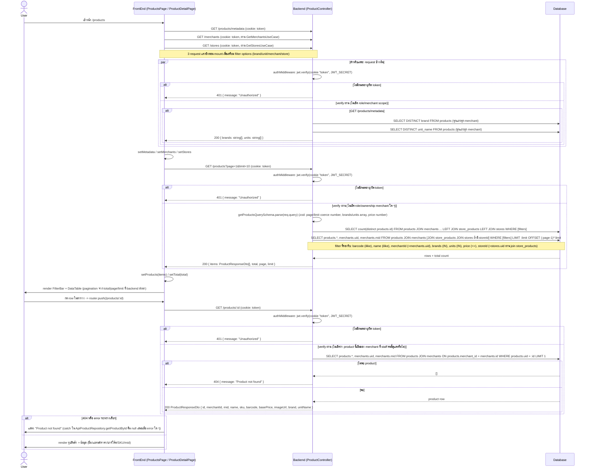

# Product List & Detail Flow (ของจริงในโค้ดปัจจุบัน)

## สิ่งที่ต่างจาก "มาตรฐานที่ควรมี"

โค้ดปัจจุบัน (`apps/portal-service/src/presentation/routes/product.routes.ts`, `ProductController.getAll/getMetadata/getById`, `GetProductsUseCase`, `GetProductDetailUseCase`, `GetProductFilterMetadataUseCase`, `DrizzleProductRepository`, และฝั่ง client `apps/portal/src/app/(authenticated)/products/page.tsx` และ `apps/portal/src/app/(authenticated)/products/[id]/page.tsx`) มีพฤติกรรมดังนี้:

| ประเด็น | ที่เป็นอยู่จริง | มาตรฐานที่ควรมี | เหตุผล |
|---|---|---|---|
| Authorization (RBAC/ownership) | authMiddleware เช็คแค่ token valid (`req.auth = { uid, role }`) แต่ controller ทั้ง 3 endpoint ไม่ได้ใช้ `req.auth` เลย ไม่เช็คว่า staff มีสิทธิ์ดู product/merchant นั้นหรือไม่ | ควรกรองผลลัพธ์ตาม merchant ที่ staff สังกัด (ยกเว้น role super admin) ก่อน query หรือหลัง query | ป้องกัน IDOR: staff ของ merchant A เห็น/เข้าถึง product ของ merchant B ได้ทั้งจาก list (ใส่ merchantId ของคนอื่นใน filter) และจาก detail (เดา/enumerate uid) |
| Route ordering ของ `/products/metadata` vs `/products/:id` | `product.routes.ts` register ตามลำดับ: `GET /products`, `GET /products/metadata`, `POST /products/batch`, `POST /products`, `GET /products/:id` — Express จับคู่ route ตามลำดับ register ไม่ใช่ตาม specificity ดังนั้น `GET /products/metadata` ที่ register มาก่อน `GET /products/:id` จะถูกจับคู่ก่อนเสมอ ไม่มี conflict จริงในโค้ดปัจจุบัน | ยังปลอดภัยตามลำดับปัจจุบัน แต่ควร comment ในโค้ดหรือเขียน route คงที่ (`/metadata`) ไว้เหนือ route ที่มี param เสมอเป็นธรรมเนียม เพื่อกัน regression ถ้ามีคนย้ายลำดับในอนาคต | ถ้ามีคนย้าย `router.get('/products/:id', ...)` ไปไว้ก่อน `router.get('/products/metadata', ...)` โดยไม่รู้ตัว จะทำให้ request ไป `/products/metadata` ถูกตีความเป็น `id = "metadata"` แล้วหา product ไม่เจอ (404) ทันที |
| Data scoping ของ `/products/metadata` | `getMetadata()` ดึง brand/unit distinct จากสินค้า "ทุก merchant" ในระบบ ไม่ filter ตาม merchant ของ staff หรือ merchant ที่กำลังเลือกอยู่ในหน้า filter | ควรรับ `merchantId` (หรือใช้ merchant ของ staff) มา filter brand/unit เฉพาะของ merchant ที่เกี่ยวข้อง | staff ของ merchant A จะเห็น dropdown brand/unit ที่จริง ๆ มาจากสินค้าของ merchant อื่นปนอยู่ ทำให้ filter ใช้งานสับสนและรั่วข้อมูลชื่อแบรนด์ของธุรกิจอื่น |
| Pagination ของ GET /products | มี page/limit จริง (`zod coerce`, default page=1 limit=10) และ backend ทำ LIMIT/OFFSET ใน SQL จริง พร้อม total count แยก query | ใช้ได้ตามมาตรฐานอยู่แล้ว ควรเพิ่ม upper bound ให้ `limit` (เช่น max 100) กัน client ขอ limit สูงเกินไป | ปัจจุบัน `limit` ไม่มีเพดานสูงสุด ถ้า client ส่ง `limit=1000000` จะ query ทั้งตารางออกมาในครั้งเดียว |
| Consistency ของ error เมื่อ merchant/product ไม่พบ | `GET /products/:id` ตอบ 404 ชัดเจนเมื่อไม่พบ แต่ `GET /products?merchantId=xxx` ที่ merchantId ไม่มีอยู่จริงจะตอบ 200 พร้อม `items: []` แทนที่จะแจ้งว่า merchant ไม่พบ | ควรตอบสถานะให้สอดคล้องกัน หรืออย่างน้อย distinguish "merchant ไม่มีอยู่จริง" กับ "merchant มีแต่ไม่มีสินค้า" | ฝั่ง client ต้องเดาเองว่า filter merchantId ผิดหรือ merchant นั้นแค่ยังไม่มีสินค้า |
| Frontend error handling ของหน้า detail | `ApiProductRepository.getProductById` ดัก `catch` ทุก error (401/404/network) แล้ว return `null` เหมือนกันหมด หน้า detail แสดง "Product not found" ทุกกรณี | ควรแยกกรณี 401 (redirect ไป login) ออกจาก 404 จริง (ไม่พบสินค้า) | ถ้า session หมดอายุระหว่างเปิดหน้า detail ผู้ใช้จะเห็นข้อความ "Product not found" ที่ทำให้เข้าใจผิดว่าสินค้าไม่มีอยู่จริง ทั้งที่จริง ๆ แค่ token หมดอายุ |
| Audit log | ไม่มีการบันทึกว่า staff คนไหนดู/ค้นหา product รายการไหนบ้าง | ควร log การเข้าถึงข้อมูล product โดยเฉพาะการ list แบบ filter ตาม merchant คนอื่น | ใช้ตรวจสอบย้อนหลังกรณีมีการ scrape/ดูข้อมูลสินค้าของ merchant อื่นผ่านช่องโหว่ IDOR ข้างต้น |
