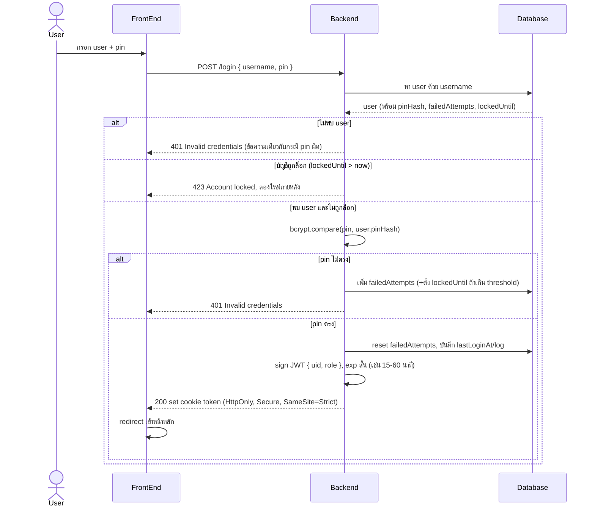

# Login Flow (Standard: User + Pin)

## มาตรฐานที่ต้องมีในระบบ login แบบ user + pin

| ประเด็น | มาตรฐาน | เหตุผล |
|---|---|---|
| เก็บ pin | hash ด้วย `bcrypt`/`argon2` (ไม่เก็บ plain text) | ป้องกันข้อมูลรั่วแล้ว pin หลุดไปด้วย |
| ข้อความ error | ตอบ "Invalid credentials" เหมือนกันทั้งกรณี user ไม่พบ และ pin ผิด | ป้องกัน user enumeration |
| Brute-force | นับ failed attempts ต่อ user (และ/หรือต่อ IP) ล็อกชั่วคราวเมื่อเกิน threshold (เช่น 5 ครั้ง ล็อก 15 นาที) | ป้องกัน brute-force เดา pin (pin สั้นกว่า password มาก เสี่ยงเดาง่าย) |
| Rate limit | จำกัดจำนวน request /login ต่อ IP ต่อช่วงเวลา (เช่น express-rate-limit) | ป้องกัน credential stuffing/DoS ที่ endpoint นี้ |
| Token | JWT อายุสั้น (15-60 นาที) + refresh token แยกต่างหากถ้าต้องการ session ยาว | ลด window ถ้า token หลุด |
| เก็บ token ฝั่ง client | httpOnly + Secure + SameSite cookie (ห้าม localStorage) | ป้องกัน XSS อ่าน token |
| Secret | `JWT_SECRET` อ่านจาก env/secret manager ไม่ hardcode ในโค้ด | ป้องกัน secret หลุดจาก source code |
| Transport | บังคับ HTTPS เท่านั้น | ป้องกัน token/pin ถูกดักระหว่างทาง |
| Audit log | บันทึก login สำเร็จ/ล้มเหลว (เวลา, IP, user) แยกจาก log ทั่วไป | ใช้ตรวจสอบเหตุการณ์ผิดปกติภายหลัง |
| CSRF | ถ้าใช้ cookie-based auth ต้องมี CSRF token คู่กับ cookie สำหรับ request ที่เปลี่ยนแปลงข้อมูล | cookie ถูกแนบอัตโนมัติ เสี่ยง CSRF ถ้าไม่ป้องกัน |
