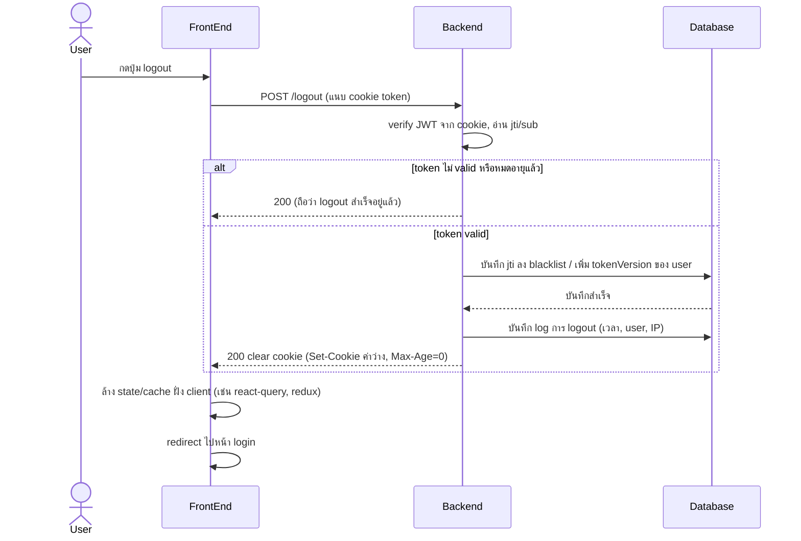

# Logout Flow

## มาตรฐานที่ต้องมีในระบบ logout

| ประเด็น | มาตรฐาน | เหตุผล |
|---|---|---|
| เคลียร์ cookie | ตอบกลับ `Set-Cookie` เดิมด้วยค่าว่างและ `Max-Age=0`/`Expires` อดีต พร้อม path/domain ตรงกับตอน set | ถ้า path/domain ไม่ตรง cookie จะไม่ถูกลบจริง |
| Invalidate token ฝั่ง server | เก็บ `jti` ที่ logout แล้วใน blacklist (เช่น Redis, TTL = อายุ token ที่เหลือ) หรือเพิ่ม `tokenVersion` ต่อ user แล้วเช็คตอน verify | JWT ปกติ stateless เพิกถอนไม่ได้ก่อนหมดอายุ ต้องมี mechanism แยก ไม่งั้น token ที่หลุดไปแล้วยังใช้ได้ต่อจนกว่าจะหมดอายุ |
| Refresh token | ถ้ามี refresh token แยก ต้อง revoke/ลบออกจาก store ด้วยตอน logout | ป้องกันการขอ access token ใหม่หลัง logout |
| Logout ทุก session (ถ้ามี requirement) | เพิ่ม `tokenVersion`/`sessionVersion` ของ user แล้วให้ token เก่าทุกตัว invalid พร้อมกัน | ใช้กรณี "logout จากทุกอุปกรณ์" หรือสงสัยว่า token หลุด |
| Client state | ล้าง cache/state ที่เก็บข้อมูล user ไว้ฝั่ง client (memory, react-query cache, localStorage ที่ไม่ใช่ token) ก่อน redirect | ป้องกันข้อมูล user เก่าค้างแสดงถ้ามี user อื่น login ต่อบนเครื่องเดียวกัน |
| Idempotent | เรียก `/logout` ซ้ำ หรือ token หมดอายุ/ไม่ valid อยู่แล้ว ต้องตอบ success เหมือนกัน ไม่ error | logout ควรจบด้วยผลลัพธ์เดียวกันเสมอ ไม่ควรทำให้ user ติดอยู่ |
| CSRF | ถ้า `/logout` เปลี่ยน state (เขียน DB/cookie) ผ่าน cookie-based auth ต้องมี CSRF token เหมือน request เปลี่ยนแปลงข้อมูลอื่น | ป้องกันการถูกบังคับ logout จากเว็บอื่น (CSRF) |
| Audit log | บันทึกเวลา, user, IP ตอน logout แยกจาก log ทั่วไป | ใช้ตรวจสอบ session/เหตุการณ์ผิดปกติภายหลัง |
| Transport | บังคับ HTTPS เท่านั้น | ป้องกัน cookie/token ถูกดักระหว่างทาง |
