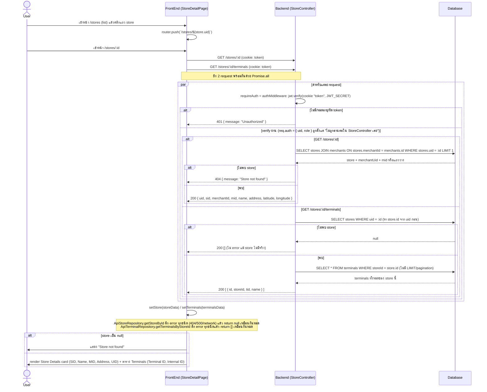

# Store Detail Flow (ของจริงในโค้ดปัจจุบัน)

## สิ่งที่ต่างจาก "มาตรฐานที่ควรมี"

โค้ดปัจจุบัน (`apps/portal-service/src/presentation/routes/store.routes.ts`, `StoreController.getById/getTerminals`, `GetStoreDetailUseCase`, `GetTerminalsByStoreUseCase`, `DrizzleStoreRepository.getById`, `DrizzleTerminalRepository.findByStoreId`, และฝั่ง client `apps/portal/src/app/(authenticated)/stores/[id]/page.tsx`, `ApiStoreRepository`, `ApiTerminalRepository`) มีพฤติกรรมดังนี้ (ดู background เพิ่มเติมเรื่อง auth/JWT ที่ `docs/portal/flow/merchant-detail.md` เพราะ mechanism เหมือนกันทุกประการ):

| ประเด็น | ที่เป็นอยู่จริง | มาตรฐานที่ควรมี | เหตุผล |
|---|---|---|---|
| Authorization (RBAC/ownership) | `authMiddleware` เซ็ต `req.auth = { uid, role }` จาก JWT แต่ `StoreController` ไม่เคยอ่าน `req.auth` เลย — ใครก็ตามที่ login (role/merchant อะไรก็ได้) ใส่ store uid ใน URL ได้ทุกอันแล้วเห็นข้อมูลเต็ม รวมถึง terminal ทั้งหมดของร้านนั้น | ควรเช็คว่า staff ที่ login เป็นของ merchant เดียวกับ store นี้ (หรือ super admin) ก่อนคืนข้อมูล | IDOR ชัดเจน: staff ของ merchant A เดา/ไล่ uid แล้วดู store + terminal ของ merchant B ได้ทั้งหมด (uid เป็น UUID จึงเดายากกว่า incremental id แต่ยังคง IDOR หากรั่ว/รู้ uid มาจากที่อื่น เช่น URL ที่แชร์กัน) |
| Error handling ไม่สม่ำเสมอระหว่าง endpoint | `GET /stores/:id` เมื่อไม่พบ store จะตอบ 404 ชัดเจน แต่ `GET /stores/:id/terminals` เมื่อ store ไม่มีจริงกลับตอบ 200 พร้อม `[]` เฉย ๆ (ไม่ 404) | ทั้งสอง endpoint ควรตอบสถานะให้สอดคล้องกันเมื่อ store ไม่มีอยู่จริง เช่น terminals ก็ควร 404 เช่นกัน หรือ backend ควร derive terminals จาก store ที่ผ่านการเช็คแล้วครั้งเดียว | client ไม่สามารถแยกได้ว่า "store ไม่มี terminal" กับ "store ไม่มีอยู่จริง" จาก response ของ terminals endpoint เพียงอย่างเดียว |
| Frontend กลืน error ทุกชนิดให้เป็นค่าเดียวกัน | `ApiStoreRepository.getStoreById` ดัก exception ทุกแบบ (404, 401, 500, network error) แล้ว return `null` เหมือนกันหมด → หน้าเว็บแสดง "Store not found" แม้กรณีจริงคือ session หมดอายุ (401) หรือ backend ล่ม (500); เช่นเดียวกัน `ApiTerminalRepository.getTerminalsByStoreId` ดัก error แล้ว return `[]` เงียบ ๆ | ควรแยกเคส 401 (redirect ไป login) กับ 404 (ไม่มี store จริง) กับ 5xx (แสดง error message ให้ retry) ไม่ใช่ fallback เป็นค่าว่าง/null เหมือนกันหมด | ผู้ใช้ถูกหลอกว่า "ไม่มีร้านนี้" ทั้งที่จริงอาจเป็นปัญหาเครือข่าย/เซิร์ฟเวอร์/สิทธิ์การเข้าถึง ทำให้ debug และ UX สับสน |
| Pagination ของ terminals | `findByStoreId` ดึง terminal ทั้งหมดของ store มาโดยไม่มี LIMIT/OFFSET | ควรมี pagination ถ้าจำนวน terminal ต่อร้านอาจมาก | ป้องกัน response ใหญ่เกินไปหากร้านมี terminal จำนวนมาก |
| Stores list ไม่กรอง/ไม่ scope ตาม merchant ของผู้ใช้ | หน้า `/stores` list เรียก `GetStoresUseCase.execute()` โดยไม่ส่ง `merchantId` เลย → backend คืน store "ทั้งหมดในระบบ" ทุก merchant มาที่ client แล้วค่อย filter/paginate ฝั่ง browser (เหมือน pattern ที่พบใน merchants-list.md) | Backend ควร scope ตาม merchant ของ staff ที่ login (ยกเว้น super admin) และรับ query param filter/pagination จริง | staff ของ merchant หนึ่งเห็นรายชื่อ/ที่อยู่ store ของทุก merchant ในระบบได้จากหน้า list โดยไม่ต้องรู้ uid มาก่อนด้วยซ้ำ |
| Terminal response ไม่มี field `terminals.tid` unique constraint / validation อ้างอิง | Response คืน `{ id, storeId, tid, name }` ตรงจาก DB โดยตรง ไม่มีการ mask หรือจำกัดว่าใครเห็น field ไหน | ควรพิจารณาว่ามี field ที่ sensitive (เช่น secret key ผูกกับ terminal ในอนาคต) ต้องไม่ส่งออกมาตรง ๆ | ป้องกันข้อมูลภายในหลุดออกไปกับ response หากมีการเพิ่ม field sensitive ในอนาคต |
| Audit log | ไม่มีการบันทึกว่าใคร (staff คนไหน) เปิดดู store/terminal ไหนบ้าง | ควร log การเข้าถึงข้อมูล store/terminal รายตัว โดยเฉพาะเมื่อเพิ่ม authorization check แล้ว (เพื่อ log กรณีถูกปฏิเสธด้วย) | ใช้ตรวจสอบย้อนหลังกรณีข้อมูลรั่ว หรือพบความพยายามเข้าถึง store ของ merchant อื่น |
