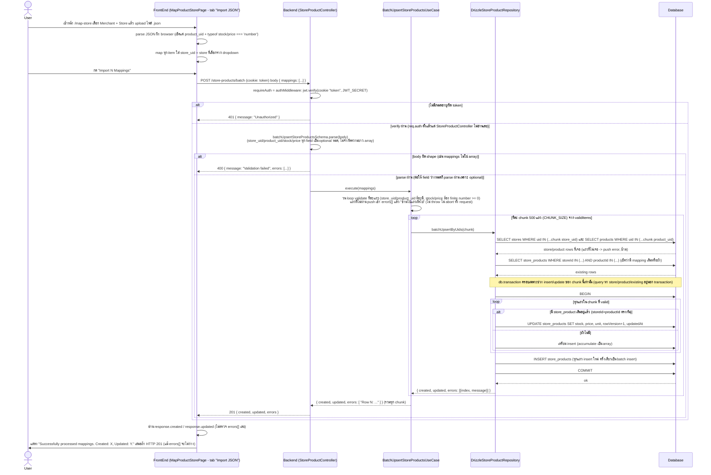

# Store Product Batch Create Flow (ของจริงในโค้ดปัจจุบัน)

## สิ่งที่ต่างจาก "มาตรฐานที่ควรมี"

โค้ดปัจจุบัน (`apps/portal-service/src/presentation/routes/storeProduct.routes.ts`, `StoreProductController.batchCreate`, `BatchUpsertStoreProductsRequestDto` (zod schema), `BatchUpsertStoreProductsUseCase`, `DrizzleStoreProductRepository.batchUpsertByUids`, `packages/models/src/storeProducts.ts`, และฝั่ง client `apps/portal/src/app/(authenticated)/map-store/page.tsx`, `ApiStoreProductRepository`) มีพฤติกรรมดังนี้:

| ประเด็น | ที่เป็นอยู่จริง | มาตรฐานที่ควรมี | เหตุผล |
|---|---|---|---|
| Authorization (RBAC/ownership) | `requireAuth` เช็คแค่ JWT valid, `req.auth` ไม่ถูกอ่านใน `StoreProductController`/`BatchUpsertStoreProductsUseCase` เลย — staff คนไหนก็ใส่ `store_uid` ของ store merchant อื่นใน mapping แล้วเขียน stock/price ทับได้ทันที | ควรเช็คว่า store ที่จะ upsert เป็นของ merchant ที่ staff คนนั้นสังกัดอยู่ (หรือ super admin) ก่อนอนุญาต | IDOR/ระดับ write: ไม่ใช่แค่ดูข้อมูล แต่แก้ไข stock/price ของร้านอื่นที่ไม่ใช่ของตัวเองได้โดยรู้แค่ `store_uid` |
| Schema validation หลวมเกินไป | `batchUpsertStoreProductsSchema` ทำให้ `store_uid`, `product_uid`, `stock`, `price` เป็น `.optional()` ทั้งหมด — zod `parse()` ผ่านแม้ mapping จะเป็น `{}` ว่างเปล่า การเช็ค "required" จริง ๆ ไปอยู่ใน loop ของ use case (push เข้า `errors[]` แทนที่จะ reject request) | field ที่ required ทางธุรกิจ (store_uid, product_uid, stock, price) ควรกำหนดเป็น required ใน zod schema เพื่อ reject ตั้งแต่ชั้น validation (400) ไม่ใช่ปล่อยผ่านแล้วไป "soft fail" เป็นรายแถว | zod schema ไม่ได้สื่อ contract จริงของ API และทำให้ error handling กระจายอยู่ 2 ชั้น (schema กับ business logic) โดยไม่จำเป็น |
| ไม่จำกัดขนาด batch จาก client | schema ไม่มี `.max()` บน `mappings` array — client ส่ง mapping กี่พันกี่หมื่นแถวก็ parse ผ่านหมด (แค่ประมวลผลช้าเพราะแบ่งเป็น chunk ละ 500 ภายใน use case) และ `express.json({ limit: '10mb' })` เป็นเพดานเดียวที่จำกัดจริง | ควรกำหนด max length ของ `mappings` ต่อ request ที่ชั้น validation (เช่น ไม่เกิน 1000–5000 แถว) และคืน 400 ถ้าเกิน | ป้องกัน request เดียวที่มี payload ใหญ่มากทำให้ backend ใช้เวลา/memory/DB connection นานผิดปกติ (DoS โดยไม่ตั้งใจหรือตั้งใจ) |
| Atomicity ข้าม chunk | แต่ละ chunk (500 แถว) ถูก wrap ด้วย `db.transaction` แยกกัน — ถ้า chunk ที่ 2 จาก 3 เกิด error (เช่น DB connection หลุด) จะ throw ออกไปที่ `errorMiddleware` (500) แต่ chunk ที่ 1 ได้ commit ไปแล้ว ไม่มีการ rollback ข้าม chunk | ถ้าต้องการ all-or-nothing ทั้ง batch ต้องครอบทั้งการ insert/update ทุก chunk ด้วย transaction เดียว (หรือยอมรับ partial-success แต่ต้องสื่อสารให้ client เห็นชัดเจนว่าเป็น partial) | ปัจจุบันเป็น partial-commit-then-fail แบบเงียบ ๆ: response จะเป็น 500 "Internal server error" ทั้งที่บางแถวถูกเขียนลง DB ไปแล้วจริง ทำให้ client ไม่รู้ว่าอะไร apply ไปแล้วบ้าง |
| Race condition จากการไม่มี unique constraint | ตาราง `store_products` (`packages/models/src/storeProducts.ts`) มี unique constraint เฉพาะ `uid` เท่านั้น ไม่มี unique(`storeId`,`productId`) ที่ DB — โค้ดใช้ pattern "SELECT หา existing ก่อน แล้วค่อย INSERT/UPDATE" ซึ่งไม่ atomic ระดับ DB | ควรเพิ่ม unique constraint (`storeId`,`productId`) แล้วใช้ `ON CONFLICT DO UPDATE` (upsert จริงระดับ DB) แทน select-then-branch | ถ้ามี 2 request/chunk พร้อมกันเขียน mapping ของ store+product คู่เดียวกัน อาจเกิด duplicate row ใน `store_products` สำหรับคู่เดียวกัน (เพราะไม่มีอะไรกัน DB ไว้) |
| Response status ไม่สะท้อนผลจริงเมื่อ fail ทั้งหมด | ถ้าทุกแถวใน `mappings` invalid (เช่น ส่ง array ของ object ว่าง) use case จะ return `{ created: 0, updated: 0, errors: [...] }` แต่ controller ยังตอบ **201 Created** เสมอ (ไม่เช็คว่า `errors.length` เท่ากับจำนวนแถวทั้งหมดหรือไม่) | ถ้าทุกแถว fail ควรตอบ 400/422 ไม่ใช่ 201 เพราะไม่มีอะไรถูกสร้าง/อัปเดตจริง | client (โดยเฉพาะหน้า `map-store`) เชื่อ HTTP 201 แล้วขึ้นข้อความ "Successfully processed" ทั้งที่จริง ๆ import ล้มเหลวทั้งหมด |
| Frontend ไม่ตรวจ `errors[]` ในการแสดงผล | `handleImportSubmit` อ่านแค่ `response.created`/`response.updated` มาโชว์ ไม่เคยเช็คหรือแสดง `response.errors` เลยแม้ backend จะส่งมาให้ | ควรแสดงรายการ errors (เช่น "Row 5: product_uid not found") ให้ผู้ใช้เห็นว่าแถวไหนถูกข้ามไปบ้าง | ผู้ใช้ import ไฟล์ที่มีบางแถวผิด (เช่น product_uid พิมพ์ผิด) แล้วเข้าใจผิดว่า mapping ทุกแถวถูกบันทึกสำเร็จหมด ทั้งที่บาง row ถูก skip เงียบ ๆ |
| Manual "Key In" tab เป็น mock ไม่ได้เรียก API จริง | ปุ่ม "Save Mapping" ในแท็บ Manual เรียก `handleManualSubmit` ซึ่งแค่ `console.log` + `alert('Mapping saved successfully! (Mock)')` ไม่มีการยิง `ApiStoreProductRepository`/`POST /store-products/batch` ใด ๆ เลย | ถ้า flow นี้ยังใช้งานจริงในหน้า UI ควรต่อเข้ากับ endpoint เดียวกัน (ส่ง mapping เดียวเป็น array ขนาด 1) หรือถอด UI ออกถ้ายังไม่พร้อมใช้งาน | ผู้ใช้กรอกฟอร์ม manual แล้วเห็นข้อความ "saved successfully" ทั้งที่ไม่มีอะไรถูกบันทึกลง backend จริง เป็นความเสี่ยง UX/data-loss ที่มองไม่เห็น |
| Audit log | ไม่มีการบันทึกว่า staff คนไหน (จาก `req.auth.uid`) ยิง batch import เข้า store ไหน จำนวนกี่แถว เมื่อไหร่ | ควร log ทุกครั้งที่มีการ bulk write ราคา/สต๊อกของร้าน พร้อม actor และ payload summary | การ import แบบ batch กระทบข้อมูลจำนวนมากในครั้งเดียว (ราคาขาย/สต๊อกสินค้า) จำเป็นต้อง trace ย้อนหลังได้ว่าใครเป็นคนทำเมื่อเกิดปัญหาราคาผิด |
