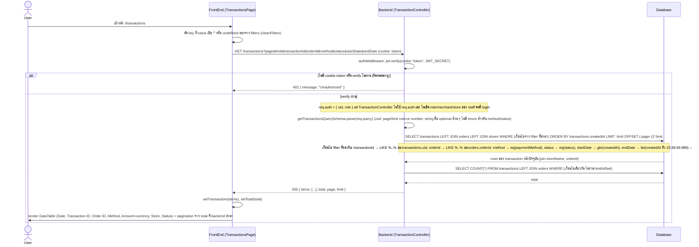

# Transaction List Flow (ของจริงในโค้ดปัจจุบัน)

## สิ่งที่ต่างจาก "มาตรฐานที่ควรมี"

โค้ดปัจจุบัน (`apps/portal-service/src/presentation/routes/transaction.routes.ts`, `TransactionController.getAll`, `GetTransactionsUseCase`, `DrizzleTransactionRepository.getTransactions`, DTO `GetTransactionsQueryDto`/`TransactionResponseDto`, และฝั่ง client `apps/portal/src/app/(authenticated)/transactions/page.tsx` + `ApiTransactionRepository`) มีพฤติกรรมดังนี้:

| ประเด็น | ที่เป็นอยู่จริง | มาตรฐานที่ควรมี | เหตุผล |
|---|---|---|---|
| Data scoping / IDOR | ไม่มี filter ตาม merchant/store ของ staff ที่ login เลย และไม่รับ `merchantId`/`storeId` เป็น query param ด้วยซ้ำ — `TransactionController.getAll` ไม่แตะ `req.auth` เลย | ต้อง filter ธุรกรรมด้วย merchant/store ที่ staff คนนั้นสังกัด (ยกเว้น role ที่เป็น super admin จริง ๆ) ก่อน query | staff ของ merchant ไหนก็ตามที่ login ผ่านระบบ เห็น**ธุรกรรมทางการเงินของทุก merchant/ทุกร้านในระบบ**ได้หมด (จำนวนเงิน, ช่องทางจ่าย, สถานะ) แค่ยิง `GET /transactions` เฉย ๆ — รุนแรงกว่ากรณี merchants-list เพราะเป็นข้อมูลการเงินโดยตรง |
| Authorization (RBAC) | authMiddleware เช็คแค่ token valid ไม่มีการเช็ค role ว่าดู transaction ได้หรือไม่ | ควรจำกัด role ที่เข้าถึง endpoint นี้ได้ (เช่น เฉพาะ owner/finance/admin) | ป้องกัน staff ระดับ cashier เห็นรายงานการเงินรวมของทั้งระบบ |
| การเรียงลำดับผลลัพธ์ | `.orderBy(transactions.createdAt)` ไม่ใส่ `desc()` → เรียงจากเก่าไปใหม่ (ascending) หน้าแรกจะเป็นธุรกรรมเก่าสุดในระบบ ไม่ใช่ล่าสุด | ตาราง transaction ควร default เรียงใหม่ไปเก่า (`desc`) เพื่อให้เห็นธุรกรรมล่าสุดก่อน | ผู้ใช้เปิดหน้า transactions มาเพื่อดูรายการล่าสุดเป็นหลัก การ default เป็น ascending ทำให้ต้องไล่ไปหน้าสุดท้ายเพื่อดูของใหม่ |
| Validation ของ filter | `method`/`status` เป็น `z.string().optional()` เฉย ๆ ไม่ validate กับ enum (`TransactionMethod`/`TransactionStatus` ที่มีอยู่แล้วฝั่ง frontend) ก่อนเอาไปต่อ query (`eq(transactions.paymentMethod, filters.method)`) | ควร validate ด้วย zod enum ให้ตรงกับค่าที่ domain รองรับจริง | ค่าที่พิมพ์ผิด/ค่าที่ไม่มีจริงจะผ่าน validation ไปถึงชั้น query เฉย ๆ (ได้ผลลัพธ์ว่างแบบเงียบ ๆ) แทนที่จะ error 400 บอก client ชัด ๆ ว่าใส่ผิด |
| `transactionId`/`orderId` filter | ใช้ `LIKE %input%` ต่อ input ดิบจาก query string โดยตรง ไม่ escape ตัวอักษร wildcard ของ SQL (`%`, `_`) | ควร escape wildcard character ก่อนสร้างเงื่อนไข LIKE หรือใช้ full-text/exact match ตามความเหมาะสม | ผู้ใช้ใส่ `%` หรือ `_` ในช่อง search จะได้ผลลัพธ์ที่กว้าง/แคบกว่าที่ตั้งใจโดยไม่รู้ตัว (ไม่ใช่ SQL injection เพราะ drizzle parameterize ให้ แต่ผลลัพธ์การค้นหาไม่ตรงเจตนา) |
| Amount precision | `amount: Number(t.amount)` แปลงค่าเงินจาก DB เป็น JS `number` (floating point) ตรง ๆ ทั้งใน entity และ response DTO | เงินควรเก็บ/ส่งเป็นหน่วยที่แม่นยำ (integer minor unit เช่นสตางค์ หรือ decimal string) ไม่ผ่าน floating point | เสี่ยง rounding error สะสมเมื่อจำนวนธุรกรรมเยอะขึ้นหรือมีการคำนวณต่อยอดฝั่ง frontend |
| Pagination | มี `page/limit` จริงและ query ที่ DB ด้วย `LIMIT`/`OFFSET` พร้อม query `COUNT(*)` แยกสำหรับ `total` (ดีกว่ากรณี merchants-list ที่ดึงทั้งหมดมา filter ที่ client) | เหมือนเดิม เป็นรูปแบบที่ถูกต้องอยู่แล้ว | ไม่พบปัญหาใหญ่ในส่วน pagination |
| ความสอดคล้องของ `orderId` | entity/DTO/repository ฝั่ง backend และ entity/repository ฝั่ง frontend (`apps/portal/src/domain/entities/Transaction.ts`, `ApiTransactionRepository`) ส่งต่อ field `orderId` ตรงกันครบทุกชั้น รวมถึง frontend table มีคอลัมน์ "Order ID" แสดงผลจริง | เหมือนเดิม เป็นรูปแบบที่ถูกต้องอยู่แล้ว | ไม่พบปัญหาใหญ่ — field ที่เพิ่งเพิ่มเข้ามา (orderId) ถูก wire ครบทุก layer ไม่มีจุดตกหล่น |
| Rate limit / Audit log | ไม่มีทั้งคู่ | ควรมี rate limit และบันทึก log ว่า staff คนไหนดู/ค้นหา transaction ช่วงไหนบ้าง | endpoint นี้ให้ข้อมูลการเงินของทั้งระบบ ควร trace การเข้าถึงได้ย้อนหลัง โดยเฉพาะเมื่อรวมกับปัญหา data scoping ด้านบน |
