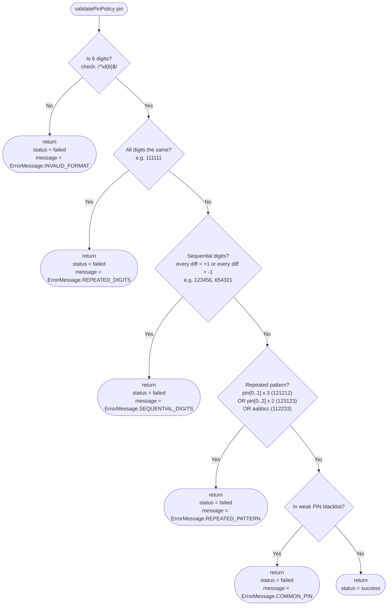
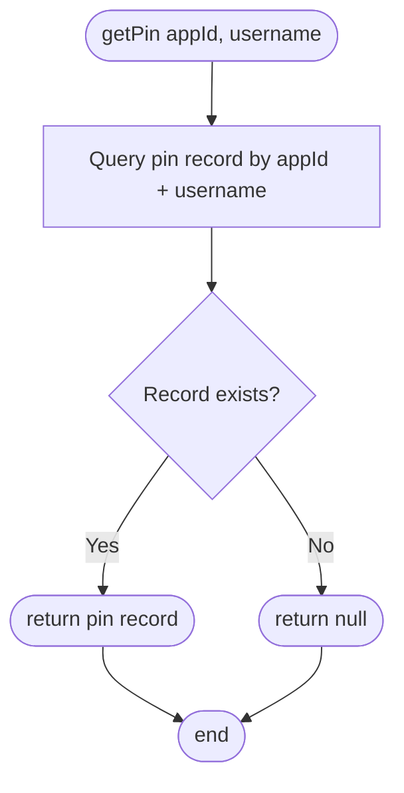
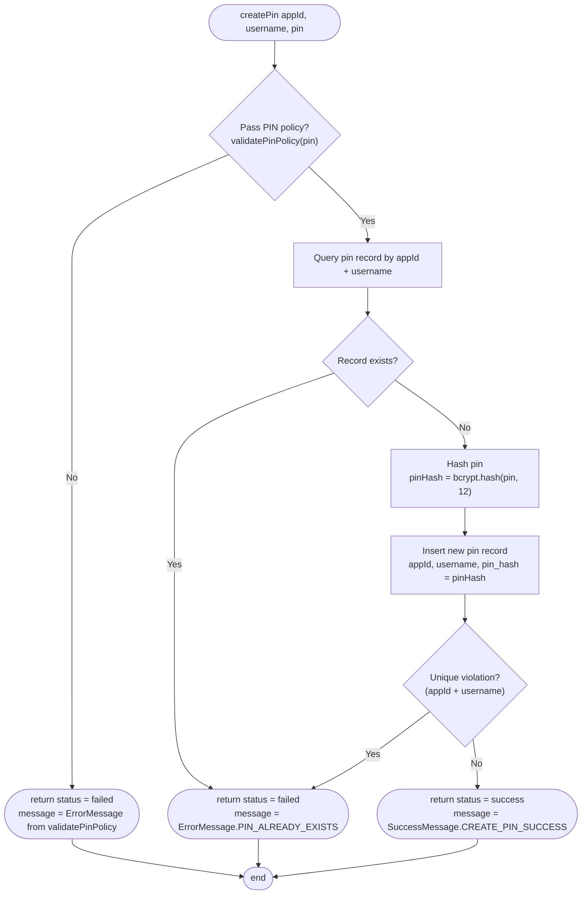
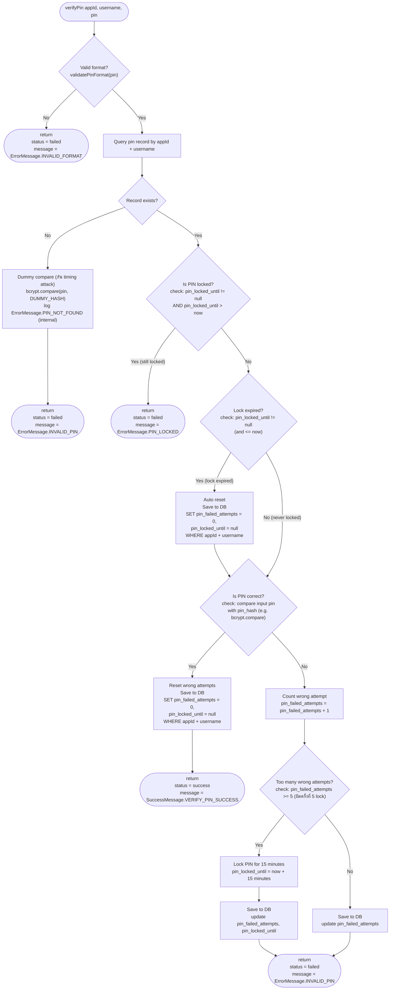
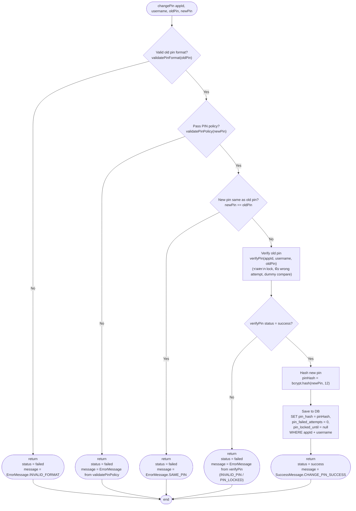

# Pin Repository

มองว่าเป็น external service ที่เก็บ PIN ของผู้ใช้แต่ละ appId + username โดยไม่เก็บ PIN จริง แต่เก็บเป็น hash (bcrypt cost 12) และมีระบบ lock / wrong attempt

## PIN policy

`createPin` ต้องตรวจสอบ PIN policy เต็ม (`validatePinPolicy`, rule 1-5) เป็นขั้นตอนแรกก่อน query DB ถ้าไม่ผ่านให้ return `status = failed` ทันที

`verifyPin` ตรวจแค่ format (`validatePinFormat`, rule 1 คือ `/^\d{6}$/`) ก่อน query DB ถ้าไม่ผ่านให้ return `status = failed` ทันที (ไม่นับเป็น wrong attempt) ไม่ตรวจ rule 2-5 เพื่อไม่ให้ผู้ใช้เดิมที่ตั้ง PIN ไว้ก่อนเปลี่ยน policy/blacklist login ไม่ได้

| #   | Rule                      | เงื่อนไข                                                                     | ตัวอย่างที่ไม่ผ่าน                     |
| --- | ------------------------- | ---------------------------------------------------------------------------- | -------------------------------------- |
| 1   | Format                    | ต้องเป็นตัวเลข 0-9 จำนวน 6 หลักเท่านั้น (`/^\d{6}$/`)                        | `12345`, `12a456`                      |
| 2   | Repeated Digits           | ห้ามใช้ตัวเลขเดียวกันทั้งหมด                                                 | `111111`, `000000`, `999999`           |
| 3   | Sequential Digits         | ห้ามเรียงกันทั้งแบบขึ้น (+1) และลง (-1) (ไม่นับแบบวนรอบ เช่น `890123` ไม่ถือเป็น sequential) | `123456`, `234567`, `654321`, `987654` |
| 4   | Pattern Repetition        | ห้ามชุด 2 หลักซ้ำ 3 รอบ (`pin[0..1]` x 3), ชุด 3 หลักซ้ำ 2 รอบ (`pin[0..2]` x 2) หรือเลขคู่ซ้ำเป็นชุด (`aabbcc`) (range นับรวมตำแหน่งปลาย) | `121212`, `123123`, `112233`           |
| 5   | Common/Weak PIN Blacklist | ห้ามอยู่ใน list PIN ยอดนิยม (top 1000 weak PINs 6 หลักจาก public leaked-password dataset เก็บเป็น constant ใน code) และต้องผ่าน rule 1-4 มาก่อน | `135791`, `159753`, `520131`           |

## Error Message

| Error Code         | Message                            | ใช้ใน                     |
| ------------------ | ---------------------------------- | ------------------------- |
| INVALID_FORMAT     | pin must be 6 digits               | validatePinFormat, validatePinPolicy |
| REPEATED_DIGITS    | pin must not be repeated digits    | validatePinPolicy         |
| SEQUENTIAL_DIGITS  | pin must not be sequential digits  | validatePinPolicy         |
| REPEATED_PATTERN   | pin must not be a repeated pattern | validatePinPolicy         |
| COMMON_PIN         | pin is too common                  | validatePinPolicy         |
| PIN_ALREADY_EXISTS | pin record already exists          | createPin                 |
| PIN_NOT_FOUND      | pin record not found               | verifyPin (internal log เท่านั้น ไม่ส่งให้ client) |
| PIN_LOCKED         | pin is locked                      | verifyPin                 |
| INVALID_PIN        | invalid pin                        | verifyPin (รวมกรณีไม่พบ record) |
| SAME_PIN           | new pin must be different from old pin | changePin             |

## Success Message

| Code               | Message                         | ใช้ใน     |
| ------------------ | ------------------------------- | --------- |
| CREATE_PIN_SUCCESS | pin record created successfully | createPin |
| VERIFY_PIN_SUCCESS | verify pin success              | verifyPin |
| CHANGE_PIN_SUCCESS | change pin success              | changePin |

## Share function



## interface

### getPin

parameters

```json
{
  "appId": "string",
  "username": "string"
}
```

return

```json
{
  "uuid": "string",
  "username": "string",
  "pinFailedAttempts": 0,
  "pinLockedUntil": "string format iso8601",
  "createdAt": "string format iso8601"
}
```

หมายเหตุ: `getPin` ไม่ return `pinHash` เด็ดขาด และ return `null` ถ้าไม่พบ record

หมายเหตุ: timestamp ทุก field เก็บใน database เป็น UTC (+0) ส่วนการแปลง timezone ทำที่ฝั่ง app

implementation



### createPin

parameters

```json
{
  "appId": "string",
  "username": "string",
  "pin": "string"
}
```

return

```json
{
  "status": "success|failed",
  "message": "string"
}
```

implementation



หมายเหตุ: `Exists` check กัน case ปกติ ส่วน unique index `(app_id, username)` ใน DB กัน race condition

### verifyPin

parameters

```json
{
  "appId": "string",
  "username": "string",
  "pin": "string"
}
```

return

```json
{
  "status": "success|failed",
  "message": "string"
}
```

implementation



หมายเหตุ: ผิดครั้งที่ 5 จะ lock 15 นาที (`pin_failed_attempts >= 5`)

หมายเหตุ: เมื่อ lock หมดอายุ `verifyPin` จะ reset `pin_failed_attempts = 0` และ `pin_locked_until = null` ให้อัตโนมัติก่อนตรวจ PIN ทำให้ผู้ใช้ได้โอกาสผิดครบ 5 ครั้งใหม่

ข้อเสนอในอนาคต: เพิ่มเวลา lock แบบ escalating (เช่น 15 นาที, 1 ชั่วโมง, 24 ชั่วโมง) ต้องเพิ่ม column เก็บจำนวนครั้งที่ถูก lock

หมายเหตุ: กรณีไม่พบ record ต้อง return `INVALID_PIN` เหมือนกรณี PIN ผิด และรัน `bcrypt.compare` กับ `DUMMY_HASH` (hash cost 12 ที่สร้างไว้ล่วงหน้า) เพื่อให้เวลาตอบใกล้เคียงกัน กัน user enumeration ส่วน `PIN_LOCKED` ยัง return ตามเดิมเพื่อให้ผู้ใช้ทราบสถานะ


### changePin

parameters

```json
{
  "appId": "string",
  "username": "string",
  "oldPin": "string",
  "newPin": "string"
}
```

return

```json
{
  "status": "success|failed",
  "message": "string"
}
```

implementation



หมายเหตุ: ตรวจ `oldPin` ด้วย `verifyPin` เพื่อให้ใช้กติกา lock / นับ wrong attempt เดียวกัน ถ้า `oldPin` ผิดจะถูกนับเป็น wrong attempt ตามปกติ

หมายเหตุ: ตรวจ `newPin` policy และ `newPin == oldPin` ก่อน query DB เพื่อไม่ให้นับ wrong attempt ในกรณีที่ input ไม่ถูกต้องอยู่แล้ว


